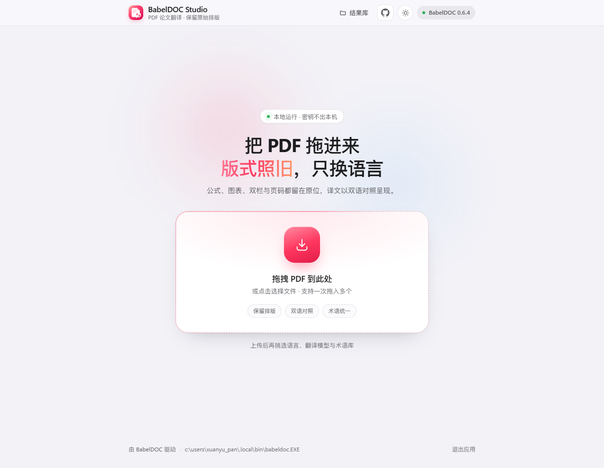
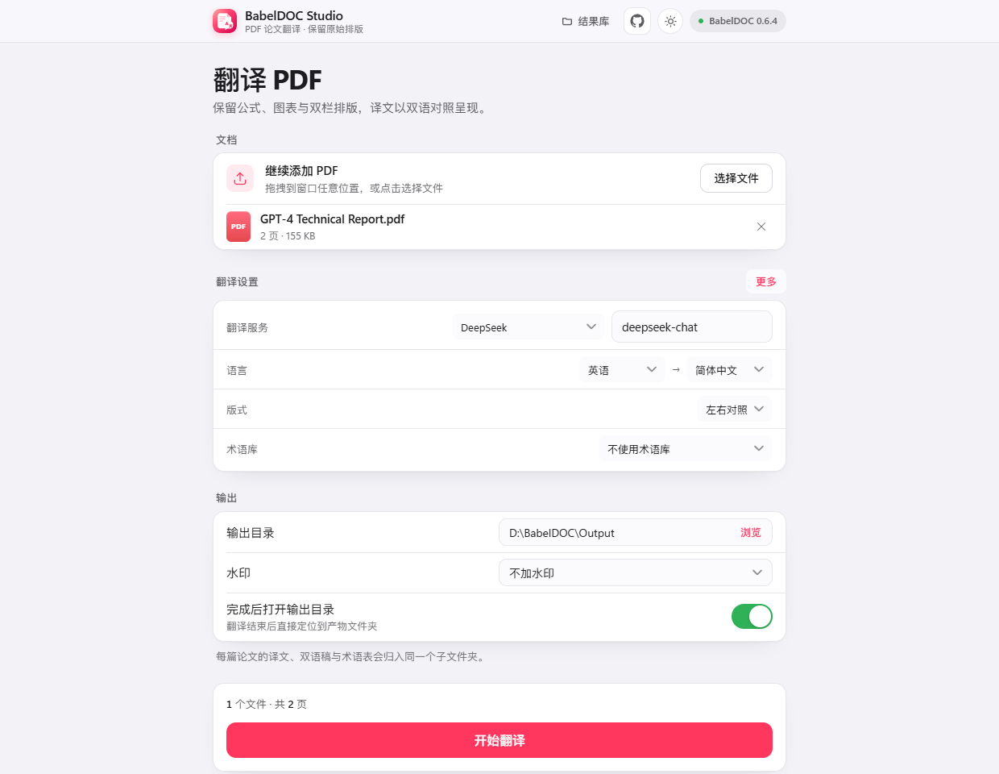
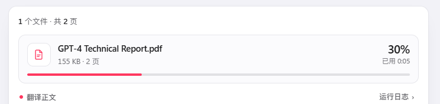
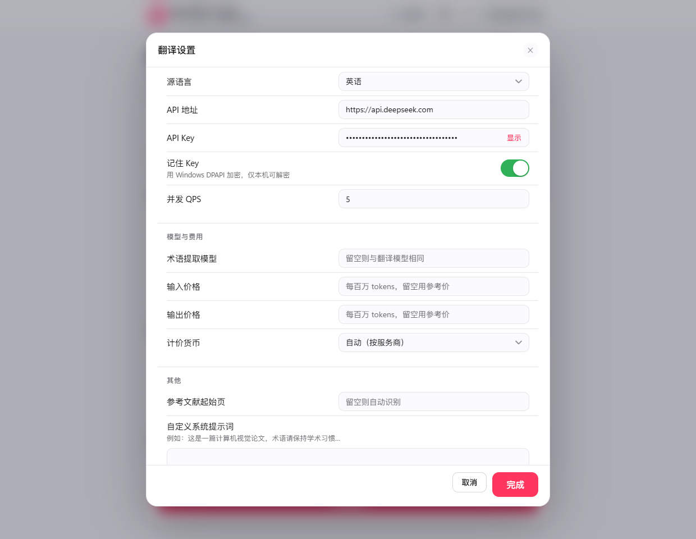
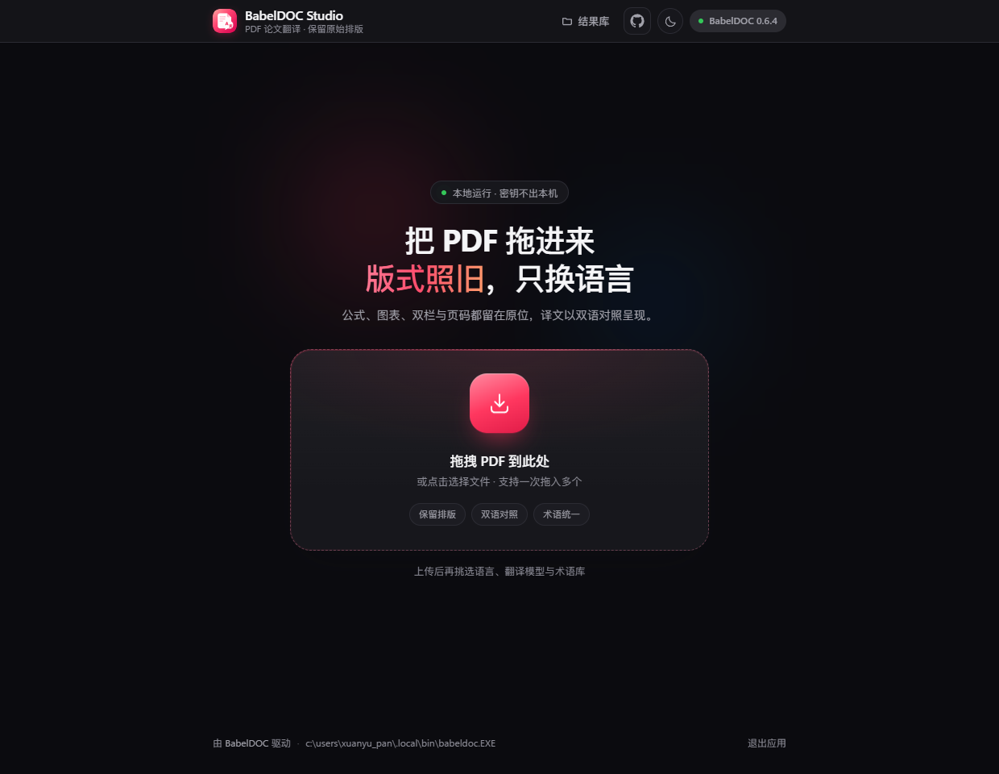
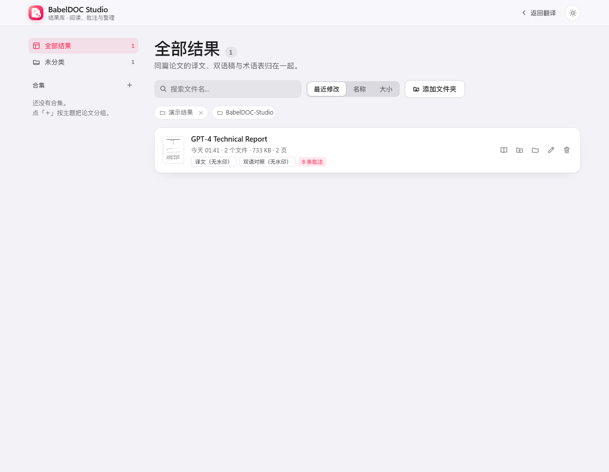
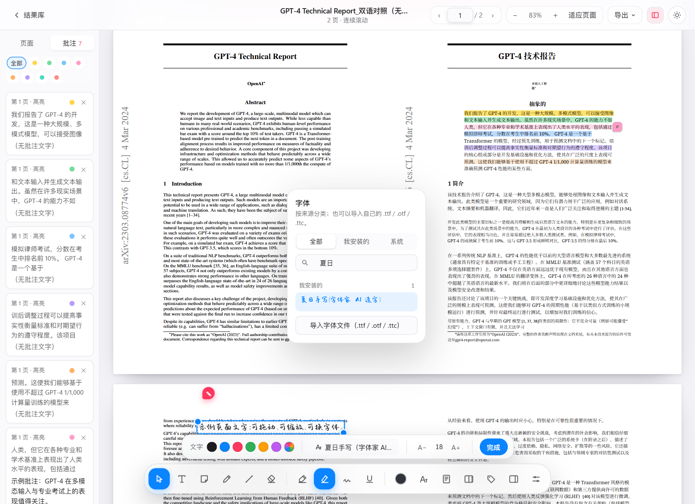
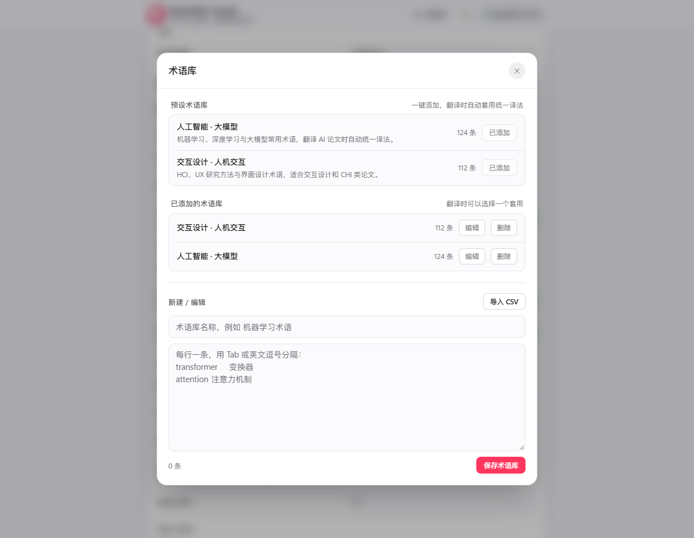

# BabelDOC Studio

> 仓库：<https://github.com/PiDesign-314/Pi_BabelDOC-Studio>

一个面向 **PDF 论文 / 技术文档** 的桌面级翻译工具：底层调用
[BabelDOC](https://github.com/funstory-ai/BabelDOC)（保留原始排版、公式、图表），
上层是本项目自研的 **Apple HIG 风格可视化界面**，可自由配置任意 OpenAI 兼容大模型。

> 本目录由旧版 Tkinter 脚本（`babeldoc_gui.py`）迁移而来，现已重写为
> 「本地 Web 服务 + 浏览器应用窗口」架构。

## 界面

上传前只保留一个拖拽入口，界面按 Apple HIG 分组呈现：



拖入 PDF 后只保留「文档 / 翻译设置摘要 / 输出」三组内容；翻译服务、模型、语言、版式、术语库直接在摘要里修改，页面范围、API Key 等完整选项收进「更多」弹窗：



开始翻译后，文件卡片显示名称、大小 / 页数、阶段进度条与已用时间；完成后显示结果文件：



翻译设置弹窗（语言、服务、版式、术语与高级选项都在这里；修改会自动保存）：



深色模式（右上角 ☀/☾ 按钮在 跟随系统 → 浅色 → 深色 之间切换）：



翻译完成后进入「结果库」：左侧按合集分组，右侧一篇论文一张分组行，可搜索、排序、归类、重命名、清理：



点开就在应用内阅读，选中正文即可高亮；带备注的划线行尾有便签标志，鼠标悬停即可预览：


选中正文后可以用八种颜色标记，也可以原地改色；侧栏还能按颜色筛选批注：


阅读器底部是一条悬浮工具坞：工具、标记样式、墨色、字体、纸面、批注版式与「颜色标签」都收在这里，顺序和显隐可自定义：


划词后可以直接挑标记样式（荧光笔 / 蜡笔 / 手绘 / 实线划线 / 铅笔划线 / 波浪线），已有标记也能原地修改样式：


「页面文字」直接在页面上输入，底部格式条可以改颜色、字体（含本机字体与导入的手写体）和字号，不再弹出编辑窗口：



批注可以选择显示在页面内，或排到页面右侧的页边距里，适合精读与水墨屏：


读「左右对照」的双语 PDF 时，在哪一侧划词，另一侧同一段落对应的句子会同步亮起：


术语库自带两套预设（人工智能、交互设计），一键添加即可让全文术语统一：



> 演示截图使用公开论文 **GPT-4 Technical Report**（arXiv:2303.08774）作为示例，不包含任何用户个人文档；译文由内置 Google 免费引擎生成，仅用于展示排版、阅读与批注功能。

## 功能指南

### 1. 翻译 PDF：保留正文、公式与图表

拖入一份或多份 PDF 后点「修改」打开翻译设置，选择语言、服务商和模型；支持 OpenAI 兼容接口、自定义网关、页面范围、QPS、提示词、OCR 兼容模式及参考文献保留。输出可选 **左右双语、交替页或仅译文**。

除了商业 API，还内置几种免费 / 本地选项：

- **Google 翻译（免费）**：应用内置免费接口，无需 Key；不经过大模型，术语与公式保留一般，接口非官方、可能限流。
- **Google Gemini**：AI Studio 免费额度，需要申请 Key（部分地区需代理）。
- **OpenRouter 免费模型**：模型名以 `:free` 结尾即免费，需要 OpenRouter Key，通常限速或排队。
- **Ollama 本地**：在本机运行，完全免费；需先安装 Ollama 并拉取模型。

免费选项的稳定性取决于对应服务；论文级术语统一仍建议使用付费大模型或配合术语库。

#### Token 用量与费用参考

每次任务结束后，卡片显示 **输入 token、输出 token 和按单价估算的费用**。已知模型使用内置参考价，也可在高级设置填写输入 / 输出每百万 token 单价和币种。

这不是翻译前的精确预算，也不是服务商账单：重试、缓存计价、服务商优惠和价格变化都可能影响实付。模型日志缺少用量时不虚构 token 数；未知价格时只显示用量。内置价格可能过时，请以服务商账单及自定义单价为准。

### 2. 双语阅读：划词对应显示

打开左右对照 PDF，在任意一侧选择文字，另一侧相应段落会同步亮起。对应关系根据版面和段落位置估计，适合快速对照，不保证逐词语义对齐。

- **原文随时开关**：工具坞里的「隐藏左侧原文」只展示右侧译文，再点一次恢复。适用于原文在左的横向双语页面；普通竖页、交替页和纯译文不会自动拆分。
- **连续阅读**：缩略图、缩放、适应宽度 / 页面、Ctrl + 滚轮缩放、页码导航及阅读位置恢复。
- **本地渲染**：PDF.js 和字体资源随应用附带；阅读已生成的 PDF 无需访问外部服务。

### 3. 舒适纸面与水墨屏

提供 **原色、暖米、浅绿、雾蓝、浅粉、水墨屏** 六种预设，以及自定义纸面颜色。设置会在本机浏览器保存。

水墨屏只把页面图像转成灰阶，**高亮与画笔记号保持原色**，不会被滤镜压暗。纸面与水墨屏都不会修改 PDF 文件，也不等同于电子墨水硬件；需要判断图表原始色彩时切回「原色」。

### 4. 阅读批注与随手记录

#### 高亮、划线与颜色标签

选中文字后，点击八色预设即可标记。划词工具条和批注编辑器里都能选 **荧光笔、蜡笔（颗粒条纹）、手绘（不规则边缘）、实线划线、铅笔划线（细虚线）、波浪线**；打开已有标记后也能直接换样式。

默认 **绿色 = 结论、红色 = 重点、黄色 = 疑问**，另有证据、灵感、待办、定义、方法。点工具坞的标签图标打开「颜色标签」，可给每种颜色改名，也能关掉「显示功能提示」；悬停或键盘聚焦色块时显示提示。侧栏顶部的色点还能只显示某一种颜色的批注。

「批注显示」可以在 **页面内 / 页边距** 之间切换：页边距模式会把带备注的批注排到页面右侧，并用引线连回被批注的句子（卡片避让错开时也不会指错行），页面自动缩窄让出空间；窗口小于 860px 时自动回到页面内。

#### 便签、页面文字、直线与曲线

- **便签移动**：选择工具坞的便签（或按 N）后点击页面放置；在「选择 / 移动」模式拖动便签。坐标按 PDF 单位保存，缩放后仍保持位置。
- **页面文字（就地编辑）**：选择「页面文字」并点击页面，直接在页面上输入，不再弹出编辑窗口；输入时底部出现文字格式条，可改 8 种预设颜色 / 自定义颜色、字体、字号；编辑时文字四周出现虚线框，拖动左上把手可移动位置，拖动右下把手可缩放字号。点击已有文字即可继续编辑；空白文字结束编辑时会自动移除，也不会误触发便签。
- **字体**：字体浮层按「全部 / 我安装的 / 系统」分组（参考 Figma 的分类方式），列出 Windows 已安装字体，支持搜索与预览；也可以导入 `.ttf / .otf / .ttc` 字体（例如中文手写体），导入后只保存在本机，不会进入仓库或安装包。
- **随意画**：自由画曲线或直线，设置颜色、粗细和不透明度；点击已有笔迹可编辑参数。「橡皮擦」按整笔删除，不擦除 PDF 正文。
- **右键**：在选中的文字上右键，菜单直接给出六种标记样式和八种颜色，不再出现橡皮擦；右键已有批注可改色、编辑或删除。空白处右键仍是工具菜单。Esc 回到选择。
- **自定义工具栏**：工具坞最右侧的滑杆按钮可调整工具顺序、隐藏不常用的工具或恢复默认；选择 / 页面文字 / 便签 / 自由画 / 直线 / 橡皮擦也支持 V / T / N / P / L / E 快捷键。
- **动效**：弹窗淡入与轻微缩放、按钮按压反馈，遵循系统「减少动态效果」。

#### 保存、导出与分享

批注自动保存在本机，可从侧栏跳转、编辑或删除；侧栏可拖动右边缘调整宽度，双击复位。支持导出 Markdown 和带批注 PDF 副本（快捷键 Ctrl+S）。笔迹在 Markdown 中用文字说明，查看图形请导出 PDF。

如果应用窗口还在使用旧的后端进程（例如更新程序后没有重启），新批注会暂时写不进磁盘：阅读器顶部会出现「重启应用」提示条，点一下即可重启并自动刷新，不再只弹一句「有批注没能保存」。

PDF 导出使用标准高亮 / 划线 / 便签 / 自由文字 / 墨迹注释，并附带本应用可读的编辑信息。导出的自由文字使用兼容中文字体，可能与阅读器选中的本地字体不同；铅笔样式在其他 PDF 阅读器中显示为标准下划线。返回本应用可恢复所选字体和样式。

### 5. 结果库与术语管理

同篇论文的译文、双语 PDF、术语表自动归组，支持搜索、排序、重命名、合集、回收站及打开文件夹。支持添加其他结果目录。

术语库可新建、编辑、导入 CSV，随应用附带人工智能 / 大模型、交互设计 / 人机交互两套预设；翻译前可自动提取术语并保存复用。API Key 在 Windows 使用 DPAPI 加密保存。

## Windows 免安装版本

仓库已提供 Windows x64 ZIP 的构建与 Release 草稿工作流。发布后的文件位于 [Releases](https://github.com/PiDesign-314/Pi_BabelDOC-Studio/releases)，**请下载带 `Windows-x64.zip` 的附件，而非 GitHub 的 Source code ZIP**。若尚无此附件，表示维护者尚未完成发布。

1. 将整个压缩包解压到可写目录（不要直接在压缩包里运行）。最新版本为 **v1.4.0**。
2. 双击 **Start.bat**。包内包含 Python、BabelDOC、依赖及离线模型 / 字体资源，无需另装 Python 或 pip。
3. Windows 10/11 x64 使用已安装的 Edge / Chrome 打开应用窗口；翻译仍需配置模型 API，调用在线模型时需要联网。

### 更新与卸载

关闭旧程序后，将新版解压到新目录再启动。设置、术语库、批注默认在 `%APPDATA%\BabelDOC-Studio`；译文默认在「文档」中的 `BabelDOC-Studio`；BabelDOC 的模型缓存由上游在用户缓存目录管理。

删除旧程序目录即可卸载该版本。若要彻底清除个人数据，先备份译文及批注，再手动删除上述数据目录。浏览器中的外观和纸面偏好属于本机站点数据。移动已翻译 PDF 的位置可能改变批注关联，建议先导出带批注 PDF。

### 解压即用的利弊

| 优点 | 代价 |
| --- | --- |
| 无需管理员权限或手动安装 Python | 下载体积较大，包含运行环境、模型和字体 |
| 新旧版本可分目录保留、方便回退 | 全量更新需要重新下载整个包 |
| 删除程序目录即可移除程序 | 为防误删，个人数据和缓存不会随程序自动删除 |
| 运行环境固定，减少依赖冲突 | 维护者需要持续更新依赖，并分别构建不同平台版本 |

### 维护者构建

在 Windows x64 / Python 3.12 环境运行 `python tools/build_portable.py`。构建脚本生成 `dist/BabelDOC-Studio-Windows-x64.zip` 和 SHA-256 校验文件，包含依赖清单和依赖自带的许可证。打包时不复制个人设置、密钥或论文。

GitHub Actions 的 **Windows portable** 可手动运行并下载构建产物；推送 `v*` 标签时生成 Release 草稿，经验证后发布。构建使用 BabelDOC 官方的 [离线资源生成 / 恢复功能](https://funstory-ai.github.io/BabelDOC/)。

## 源码启动（开发者）


前置条件：

1. 安装 BabelDOC（命令行版）：

   ```powershell
   uv tool install babeldoc
   # 或：pip install babeldoc
   ```

2. Python 3.10+，并安装两个依赖：

   ```powershell
   pip install flask pymupdf
   ```

然后双击 **`启动.bat`**。它会启动本地服务（默认 `http://127.0.0.1:8765`）并用
Edge/Chrome 的应用窗口打开界面。

桌面快捷方式：`BabelDOC Studio`（指向 `pythonw.exe app.py`，图标为
`web/babeldoc.ico`，由 `tools/make_icon.py` 生成）。重复双击不会重复启动服务，
只会再开一个窗口；界面右下角「退出应用」可停掉本地服务。项目路径变动后，
重新运行 `tools/create_shortcut.ps1` 即可刷新快捷方式。

调试时可直接运行（保留控制台输出）：

```powershell
python app.py            # 打开应用窗口
python app.py --server-only   # 只启动服务，自己用浏览器访问
```

## 目录结构

```
app.py                  Flask 服务 + API + 启动器
core/
  config.py             设置持久化（API Key 走 DPAPI 加密）
  providers.py          服务商预设
  languages.py          语言代码表
  glossary.py           术语库 CSV 读写
  pdfinfo.py            页数 / 大小探测
  picker.py             原生文件选择对话框（独立进程）
  runner.py             调用 babeldoc、流式日志、阶段进度、结果重命名
  library.py            结果库：扫描 / 分组 / 合集 / 重命名 / 回收站 / 缩略图
  annotations.py        阅读批注的本地存储
  fonts.py              本机 / 导入字体注册与字体文件服务
  pdfexport.py          把批注写成标准 PDF 注释，并从 PDF 读回
  presets.py            预设术语库的安装与去重
presets/
  ai-ml.csv             人工智能 · 大模型（124 条，中英对照）
  hci-ux.csv            交互设计 · 人机交互（112 条）
  index.json            预设的名称 / 描述 / 来源
web/
  index.html            翻译界面（入口 + 工作区）
  styles.css            公共样式（浅色 / 深色自适应）
  app.js                翻译界面的交互逻辑
  shared.js             结果库 / 阅读器共用的小工具
  library.html/.css/.js 结果库页面
  viewer.html/.css/.js  内置 PDF 阅读器 + 批注
  pdfjs/                PDF.js 3.11 本地副本（渲染离线可用）
docs/
  BABELDOC-NOTES.md     BabelDOC 集成笔记（CLI、产物命名、术语格式）
  screenshots/          界面截图
tests/
  test_smoke.py         命令拼装 / 阶段识别 / 产物重命名的离线测试
  test_library.py       结果库分组 / 重命名 / 删除、路径白名单、批注读写
  test_presets.py       预设术语库的列举 / 安装 / 只装一次
tools/
  make_icon.py          生成应用图标（web/babeldoc.ico）
  create_shortcut.ps1   重建桌面快捷方式
  push.ps1              提交并推送（直连失败自动走本机代理）
babeldoc_gui.py         旧版 Tkinter 界面（保留备查）
```

## 数据位置

| 内容 | 路径 |
| --- | --- |
| 设置（含加密密钥） | `%APPDATA%\BabelDOC-Studio\settings.json` |
| 术语库 | `%APPDATA%\BabelDOC-Studio\glossaries\*.csv` |
| 拖拽上传的临时 PDF | `%APPDATA%\BabelDOC-Studio\uploads\` |
| 阅读批注 | `%APPDATA%\BabelDOC-Studio\annotations\<文档>.json` |
| 导出的批注 PDF（原目录不可写时） | `%APPDATA%\BabelDOC-Studio\exports\` |
| 结果库附加目录与合集 | `%APPDATA%\BabelDOC-Studio\library.json` |
| 结果库缩略图缓存 | `%APPDATA%\BabelDOC-Studio\thumbs\` |
| 预设术语库安装记录 | `%APPDATA%\BabelDOC-Studio\presets.json` |
| 默认输出目录 | `%USERPROFILE%\Documents\BabelDOC-Studio` |

## 结果文件

BabelDOC 原始产物形如 `论文.zh.mono.pdf` / `论文.zh.dual.pdf`，本工具会自动整理，
**每篇论文一个子文件夹**，同一篇的产物都放在一起，输出目录不再被零散文件铺满：

```
<输出目录>/
  论文/
    论文_译文.pdf
    论文_双语对照.pdf
    论文_术语表.csv
  另一篇论文/
    另一篇论文_译文.pdf
    ...
```

- 子文件夹以论文名命名，重复翻译同一篇会复用这个文件夹；
- 同名文件已存在时追加 `(2)`、`(3)`，不覆盖旧结果；
- 旧版本的平铺结果（直接放在输出目录里）仍然照常识别，结果库里会各自成一张卡片；
- 在结果库里重命名论文时，这个子文件夹会一起改名；删除论文时文件夹一并清掉。

## 已验证

- 命令拼装：`--openai/--pages/--glossary-files/--no-dual/--use-alternating-pages-dual/
  --watermark-output-mode/--custom-system-prompt/--openai-term-extraction-model` 均正确生成。
- 输出整理：`paper.zh.mono.pdf` → `paper_译文.pdf`、`no_watermark` 变体 →
  `paper_译文（无水印）.pdf`、`paper.zh.glossary.csv` → `paper_术语表.csv`。
- 设置持久化：API Key 经 DPAPI 加密，明文不会出现在 `settings.json`。
- 真实调用：用 1 页 PDF 跑通 babeldoc 全流程（版面解析 → 翻译 → 排版 → 产物回收），
  断网/无效 Key 时也能正常回报失败并保留日志。
- 跳过参考文献：2 页样例（第 2 页为 References）实测只翻译第 1 页，
  输出仍是 2 页且第 2 页保留英文原文。
- 费用统计：用本地 mock LLM（每次请求固定 900 输入 / 300 输出 tokens）跑通，
  接口返回 `usage={prompt:1800, completion:600}`、`cost=¥0.0084`（deepseek-chat 参考价）。
- 结果库：产物分组、整套重命名（批注随文件迁移）、回收站删除、附加目录、路径白名单，
  以及批注读写均有离线测试（`tests/test_library.py`）；阅读器用样例 PDF 在无头浏览器里
  跑通选中高亮、便签、批注编辑与刷新后持久化。
- 预设术语库：列举 / 安装 / 只装一次（删掉不回填）有离线测试（`tests/test_presets.py`）；
  安装后出现在翻译表单的下拉里，`tgt_lng=zh` 只对中文目标生效。
- 阅读体验：页面连续滚动，读到页尾直接接上下一页；高亮按字符区间定位，再由实时文本行合并成
  连续色带，跨页选择一次就能标完；旧批注（176 段碎片矩形）打开时自动升级为字符区间，
  缩放、翻页后位置依旧准确。
- 双语对照同步：用 3 页 / 31 MB 的左右对照稿在无头浏览器里实测 —— 中文划词时英文
  一侧同一段落亮起、英文划词时中文一侧亮起，拖动过程中实时更新，点空白处清除；
  单语 PDF 不会出现任何同步标记。
- 结果文件归档：产物落到 `<输出目录>/<论文名>/`，重复翻译复用文件夹并追加 `(2)`；
  结果库能扫描子文件夹，重命名时文件夹一起改名、批注跟随，删除后空文件夹一并移除
  （`tests/test_smoke.py`、`tests/test_library.py` 覆盖）。
- 阅读流畅度：31 页 / 9.8 MB 的双语对照稿在 1280×860 窗口里连续滚动 240 帧，
  优化前平均 39–51 ms/帧（p90 64–112 ms，最长 433 ms），优化后平均 11 ms/帧
  （p90 12–15 ms，最长 61 ms）；滚动过程中读取 DOM 几何的次数从 1508–3543 次降到 0 次
  （页面偏移改为缓存的布局模型，文本层只在真正读到的页面上构建）。
- 带批注的 PDF：32 条批注导出后重新用 PyMuPDF 打开，得到 32 个 `Highlight` 注释，
  位置与原高亮一致；同一条文件再由阅读器打开，会自动读回 32 条批注并写进本地批注库
  （`tests/test_pdfexport.py` 覆盖导出 / 读回 / 跳过非法项 / 忽略他人注释 / API）。
- 八色高亮：黄 / 绿 / 蓝 / 粉 / 橙 / 紫 / 青 / 红都能保存、改色，并各自映射到 PDF 注释的描边色；
  `tests/test_pdfexport.py` 校验前后端色板一致、八种颜色导出后描边互不相同、未知颜色回落到黄色。
- 文献合集：创建 / 重命名 / 删除、归类互斥、按合集与「未分类」筛选、论文重命名后归属保留、
  论文删除后自动移出合集，均有离线测试（`tests/test_library.py`）；结果库页面在无头浏览器里
  跑通「建合集 → 归类 → 筛选 → 改名 → 删合集」全流程。
- 进度卡片：用模拟任务快照在无头浏览器里校验文件名 / 大小 / 页数、阶段进度条、
  完成态与失败态，浅色 / 深色两套主题都检查过。
- 阅读器 1.4：页面文字就地编辑（不弹窗）、颜色 / 字体 / 字号格式条、本机字体与导入手写体、
  侧栏拖宽与颜色筛选、页边距批注、工具坞排序 / 显隐、右键标记菜单、六种标记样式、
  刷新后持久化，全部由 Playwright 冒烟测试覆盖，控制台 0 错误。
- 字体：`tests/test_fonts.py` 覆盖导入、列表、文件服务、非法类型与大小限制；导入字体
  只写入 `%APPDATA%\BabelDOC-Studio\fonts`，不会进入仓库或安装包。
- Apple HIG 首页 / 结果库：浅色、深色、900px 窄窗口下 0 控制台错误，正文对比度
  4.54–18:1；用 HEAD 版 `styles.css` 与新版做 A/B，阅读器顶栏 / 侧栏 / 工具坞几何一致。
- 免费服务：内置 Google 翻译适配器（本地 OpenAI 兼容端点）端到端跑通 1 页英文 PDF，
  输出双语 PDF 的中文段落正确、无语言代码残留；Google 免费接口不可达或限流时任务会失败并保留日志。
- 翻译设置弹窗：工作区摘要、打开 / 关闭、修改服务商（含 Google 免费 / Gemini / OpenRouter 免费 / Ollama）、
  无 Key 启动守卫在无头浏览器里验证通过。
- 图标：`/favicon.svg` 与 `/favicon.ico` 由 `BabelDOC-Studio-app-icon.svg` 生成
  （矢量 5.6 KB、ICO 7.5 KB，含 16–256px 六档）；页面用 `?v=140` 绕过浏览器图标缓存，
  `tools/create_shortcut.ps1` 会刷新桌面 / 开始菜单 / 任务栏快捷方式并清理图标缓存；
  运行 `python tools/make_icon.py` 可随时重新生成。

## 术语来源

- `presets/ai-ml.csv` 部分词条参考 Yifan Wang 的
  [机器学习中英速查表](https://github.com/wangyifan411/ML-English-Chinese-Cheat-Sheet)（MIT 许可），
  并补充了 Transformer / 大模型相关术语。
- `presets/hci-ux.csv` 由本项目整理，覆盖 HCI、可用性研究与界面设计常用词。

## 已知限制

- 进度是**阶段式**（解析版面 → 提取术语 → 翻译正文 → 排版生成），
  因为 BabelDOC 命令行不提供结构化进度回调。
- 多文件翻译共用同一页面范围与同一模型设置。
- 术语库当前为单选；BabelDOC 支持多文件，UI 后续可扩展。
- 首次翻译需下载版面分析模型/字体，耗时与网速有关。
- Google 翻译使用的是非官方免费接口，可能被限流或失效；它不经过大模型，
  术语统一、公式/占位符保护与复杂排版不如 LLM，重要文档建议用付费模型或术语库。
- 字体：阅读器读取 Windows 已安装字体；导入字体只在本机生效。macOS / Linux 上暂无
  本机字体列表，回退到系统通用字族。
- 阅读器按视口附近渲染页面（前后各约 1 屏），超长文档的远端页面在滚动到时才排版；
  文字层只对正在阅读的页面构建，暂停滚动后约 0.2 s 内补齐，因此刚滚停就立刻拖选可能需要多试一次。
- 批注默认保存在应用自己的数据目录；「保存带批注的 PDF」会把它们写成标准 PDF 注释，
  但反向只读取本应用写入的注释（其它阅读器添加的高亮不会被导入）。
- 合集是「一篇论文归入若干合集」的标签式分组，不会移动磁盘上的文件；
  扫描结果是按文件名分组的，所以同一文件夹里改了名的论文会在下一次扫描时保留合集归属。
- 双语对照的对应关系是按版面位置推断的（BabelDOC 保留原排版，译文段落与原文段落基本对齐），
  不是逐句对齐：译文比原文紧凑时，高亮可能相差一两行；「交替页」模式（原文页 / 译文页分开）
  不做同步，只有左右对照的单页双栏会触发。
- 结果库只向输出目录下再扫描一层子文件夹；更深的层级不会被自动发现。

## 更新日志

各版本迭代内容见 [CHANGELOG.md](CHANGELOG.md)。

