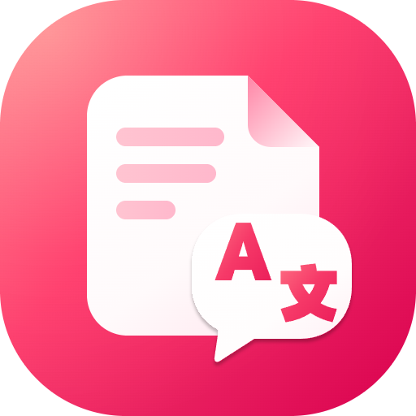
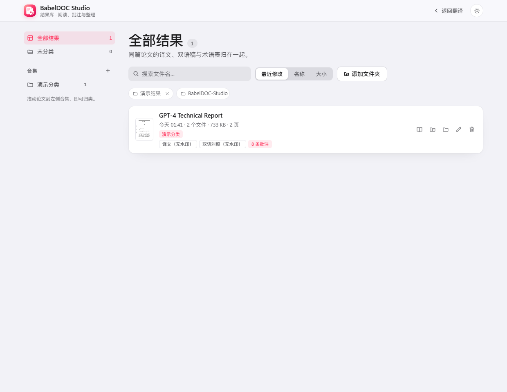

<div align="center">



<h2>BabelDOC Studio</h2>

<p><strong>把 PDF 论文翻成双语，同时保留公式、图表和原始排版。</strong></p>

<p>
  <a href="https://github.com/PiDesign-314/Pi_BabelDOC-Studio/releases/latest">
    </a>
  <a href="https://github.com/PiDesign-314/Pi_BabelDOC-Studio/releases">
    </a>
  <a href="https://github.com/PiDesign-314/Pi_BabelDOC-Studio">
    </a>
  
  
</p>

</div>

BabelDOC Studio 是一个面向 **PDF 论文 / 技术文档** 的本地翻译工作台。底层调用
[BabelDOC](https://github.com/funstory-ai/BabelDOC) 完成版面分析与重排，上层是本项目自研的
**Apple HIG 风格界面**、PDF.js 阅读器和批注系统。

- **免安装版**：Windows x64 ZIP，内置 Python、BabelDOC、离线模型与字体，解压即用。
- **本地优先**：Flask 本地服务 + Edge 应用窗口；PDF、批注和 API Key 都留在本机，Key 使用 Windows DPAPI 加密。
- **任意 OpenAI 兼容模型**：DeepSeek、智谱 GLM、Google Gemini、OpenRouter、Ollama、自定义网关；另有内置 Google 免费翻译。
- **完整的阅读与批注**：左右双语、八色高亮、手绘样式、便签、页面文字、页边距批注、术语库与结果库。
- **可直接修改的设置摘要**：服务、模型、语言、版式和术语库就在工作区改；「更多」里才是页面范围、Key 和高级选项。

> [!TIP]
> 第一次使用？直接下载 [Windows 免安装包](https://github.com/PiDesign-314/Pi_BabelDOC-Studio/releases/latest)，
> 解压后双击 `Start.bat`，不需要安装 Python。

> [!NOTE]
> 没有 API Key 也能试用：翻译设置里选择「Google 翻译（免费）」，或在本机运行 Ollama。
> Google 免费接口为非官方接口，可能限流，适合预览排版；论文级术语统一建议使用付费模型或术语库。

[更新日志](CHANGELOG.md) · [使用说明](使用说明.txt) · [上游 BabelDOC](https://github.com/funstory-ai/BabelDOC) · [支持语言](https://funstory-ai.github.io/BabelDOC/supported_languages/)

## 界面预览

<div align="center">
  
</div>

> 演示截图使用公开论文 **GPT-4 Technical Report**（arXiv:2303.08774），不包含任何用户个人文档；
> 译文由演示环境生成，仅用于展示排版、阅读与批注功能。

## 快速开始

### 下载 Windows 免安装版

1. 打开 [Releases](https://github.com/PiDesign-314/Pi_BabelDOC-Studio/releases/latest)，下载
   **`BabelDOC-Studio-Windows-x64.zip`**（不要下载 GitHub 自动生成的 Source code ZIP）。
2. 解压到一个有写入权限的目录。包内已包含 Python、BabelDOC、依赖、离线模型与字体。
3. 双击 **`Start.bat`**。应用会启动本地服务并打开 Edge / Chrome 应用窗口。
4. 上传 PDF，选择翻译服务并填入 API Key（或选择 Google 免费翻译），点击「开始翻译」。

> [!NOTE]
> 当前安装包未做代码签名，Windows SmartScreen 可能提示「未知发布者」；确认来源后选择「更多信息 → 仍要运行」。
> 更新时关闭旧程序，解压新版本到新目录即可；设置、术语库、批注和译文数据与程序目录分开保存。

### 从源码运行

前置条件：

- Windows 10/11 x64
- Python 3.10+
- 已安装 BabelDOC 命令：

```powershell
uv tool install babeldoc
# 或
pip install babeldoc
```

安装依赖并启动：

```powershell
git clone https://github.com/PiDesign-314/Pi_BabelDOC-Studio.git
cd Pi_BabelDOC-Studio
pip install flask pymupdf
python app.py
```

也可以双击仓库里的 `启动.bat`。调试时：

```powershell
python app.py                 # 启动服务并打开应用窗口
python app.py --server-only   # 只启动本地服务，用浏览器访问 http://127.0.0.1:8765
```

### 第一次翻译

1. 拖入一份或多份 PDF。
2. 在「翻译设置」摘要里直接选择服务、模型、源/目标语言、双语版式和术语库。
3. 选择商业 API 时，点「更多」填入 API Key；选择 Google 免费翻译或 Ollama 时无需 Key。
4. 点击「开始翻译」。完成后可直接进入内置阅读器，或到「结果库」查看归档文件。

<div align="center">
  
</div>

## 功能与高级选项

### 翻译与版式

- **保留原始结构**：公式、图表、双栏、脚注和页码尽量维持原位置；输出可选 **左右对照、交替页或仅译文**。
- **页面范围**：全部页或自定义范围（例如 `1-5,8`）；「不翻译参考文献」会从 References 起保留原文。
- **术语统一**：内置 AI / 大模型与交互设计两套预设术语库，也可导入自己的 CSV；支持翻译前自动提取术语。
- **兼容性选项**：跳过扫描件检测、OCR 兼容模式、自定义系统提示词、QPS 限速与参考文献起始页。
- **费用可见**：任务结束后显示输入 / 输出 token 和按可配置单价估算的费用，便于比较模型成本。

> [!TIP]
> 初次翻译需要下载版面分析模型和字体，耗时与网速有关；之后会复用本机缓存。

### 免费与本地模型

| 服务 | 需要 Key | 说明 |
| --- | :---: | --- |
| Google 翻译（免费） | 否 | 应用内置免费接口，不经过大模型；术语与公式保留一般，可能限流 |
| Google Gemini | 是 | AI Studio 提供免费额度；部分地区访问需要代理 |
| OpenRouter 免费模型 | 是 | 模型名以 `:free` 结尾即免费，通常限速或排队 |
| Ollama 本地 | 否 | 本机运行，完全免费；需先安装 Ollama 并拉取模型 |
| OpenAI / DeepSeek / GLM / Qwen / Kimi | 是 | 质量与术语统一最好，按服务商计费 |

> [!WARNING]
> Google 翻译使用非官方免费接口，稳定性和速度不受本项目控制；它不经过大模型，
> 复杂公式、占位符和长难句的效果不如 LLM。重要文档请使用付费模型或配合术语库。

### 阅读与批注

内置 PDF.js 阅读器，打开译文或双语 PDF 即可阅读和标注：

- **双语同步**：在左右对照 PDF 的任意一侧划词，另一侧对应段落会同步亮起；对应关系按版面位置估算，不保证逐词对齐。
- **八色高亮与六种样式**：荧光笔、蜡笔、手绘、实线划掉、铅笔划掉、波浪线；已有标记可原地改样式和颜色。
- **便签与页面文字**：便签可拖动；页面文字直接在页面上输入，拖动左上把手移动、右下把手缩放字号。
- **页边距批注**：批注可以显示在页面内，也可以排到页面右侧，并用引线连回被批注的句子。
- **纸面与水墨屏**：原色、暖纸、浅绿、雾蓝、浅粉、水墨屏等纸面；水墨屏只把页面转灰，批注颜色保持原样。
- **导出**：批注自动保存在本机，可导出 Markdown，或导出带标准 PDF 注释的副本（`Ctrl+S`）。

<div align="center">
  
</div>

<div align="center">
  
</div>

### 页面文字与字体

选中「页面文字」工具后点击页面即可就地输入，不再弹出独立编辑窗口：

- 底部文字格式条可改颜色、字号和字体。
- 字体浮层按「全部 / 我安装的 / 系统」分组（参考 Figma 的分类方式），支持搜索与预览。
- 可导入 `.ttf` / `.otf` / `.ttc` 字体，例如中文手写体；导入字体只保存在本机，不会进入仓库或安装包。
- 文字四周的虚线框可拖动和缩放；位置与字号按 PDF 坐标保存，刷新后保持。

<div align="center">
  
</div>

### 术语库与结果库

- 术语库支持新建、编辑和导入 CSV；预设库可在设置里一键安装，按目标语言过滤。
- 结果库把同一篇论文的译文、双语 PDF 和术语表归入同一个子文件夹，支持搜索、排序、重命名、合集、回收站和打开文件所在位置。
- **拖拽归类**：把论文卡片拖到左侧合集即可归入该合集；拖到「未分类」可移出所有合集，也可以继续用卡片上的「归类」多选。
- 在结果库中重命名论文时，子文件夹会一起改名，关联批注会跟随迁移。

<div align="center">
  
</div>

### 设置与数据

工作区摘要支持直接编辑；完整设置收在「更多」弹窗里：

<div align="center">
  
</div>

| 内容 | 路径 |
| --- | --- |
| 设置（含 DPAPI 加密的 Key） | `%APPDATA%\BabelDOC-Studio\settings.json` |
| 术语库 | `%APPDATA%\BabelDOC-Studio\glossaries\*.csv` |
| 阅读批注 | `%APPDATA%\BabelDOC-Studio\annotations\<文档>.json` |
| 拖拽上传的临时 PDF | `%APPDATA%\BabelDOC-Studio\uploads\` |
| 结果库附加目录与合集 | `%APPDATA%\BabelDOC-Studio\library.json` |
| 默认输出目录 | `%USERPROFILE%\Documents\BabelDOC-Studio` |

- API Key 使用 Windows DPAPI 加密保存，明文不会出现在 `settings.json`。
- 翻译和阅读都在本机完成；只有调用在线模型时才会把文本发送给对应服务商。
- 导出带批注 PDF 时会写入标准注释，原 PDF 文件不会被修改。

## 常见问题

### 没有 API Key 可以用吗？

可以。翻译设置里选择「Google 翻译（免费）」即可预览排版；也可以在本机安装 Ollama
并使用任意非空字符串作为 API Key。免费选项的质量和稳定性不如付费大模型。

### Google 翻译报错或一直排队？

Google 免费接口可能返回 429 限流，也可能因为网络无法访问。换用付费模型、降低 QPS，
或稍后重试；任务失败时日志里会保留具体原因。

### 批注提示「有批注没能保存」？

通常是应用窗口仍连着旧的后端进程（例如更新后没有重启）。阅读器顶部会出现「重启应用」提示条，
点一下会自动重启并刷新。仍失败时请检查 `%APPDATA%\BabelDOC-Studio` 是否可写。

### 支持 macOS / Linux 吗？

当前发布包只提供 Windows 10/11 x64。源码理论上可以在其他桌面系统运行，但字体列表、
原生文件选择器和应用窗口目前主要针对 Windows。

### 会修改原始 PDF 吗？

不会。翻译结果是新文件；阅读批注保存在应用自己的数据目录，只有主动导出带批注 PDF 时才会另存副本。

### 怎么更新或卸载？

关闭旧程序，把新版本解压到新目录再启动即可。卸载时删除程序目录；如需清除个人数据，
再手动删除 `%APPDATA%\BabelDOC-Studio` 和「文档」下的 `BabelDOC-Studio`。移动已翻译 PDF
的位置可能会改变批注关联，建议先导出带批注 PDF。

## 背景

上游 [BabelDOC](https://github.com/funstory-ai/BabelDOC) 专注于 PDF 解析、翻译与排版，主要提供
CLI / Python API；普通读者要完成一次舒服的论文翻译，还需要自己准备运行环境、模型 Key、术语表，
再找外部阅读器查看译文和做批注。

BabelDOC Studio 把这条链路收进一个本地桌面应用：

- 用本地 Flask 服务封装 BabelDOC，提供可视化任务、阶段进度、产物归档和费用统计；
- 内置 PDF.js 阅读器，把「翻译 → 对照阅读 → 高亮/便签/页边距批注 → 导出」放在同一个窗口；
- 用 Apple HIG 风格重做设置、结果库和阅读工具坞，减少命令行参数和配置文件的心智负担；
- 所有数据默认留在本机，在线模型只负责翻译文本。

## 路线图

- [x] Windows 免安装包（内置 Python / BabelDOC / 离线资源）
- [x] 内置 PDF 阅读器、八色高亮、六种标记样式与页边距批注
- [x] 页面文字就地编辑、字体分组与导入字体
- [x] 结果库、术语库预设、费用统计
- [x] 免费模型与 Google 免费翻译适配
- [ ] 扫描版 PDF 的完整 OCR 流程
- [ ] macOS / Linux 安装包与原生字体列表
- [ ] 同时启用多个术语库
- [ ] 更细粒度的逐段翻译进度
- [ ] 更多导出格式（全文 Markdown / DOCX）

## 已知限制

1. 进度是**阶段式**的（解析版面 → 提取术语 → 翻译正文 → 排版生成），不是逐段精确进度。
2. 多文件任务共用同一套页面范围、语言和模型设置。
3. Google 免费翻译是非官方接口，限流、失效和区域网络问题不受本项目管理。
4. 扫描版 PDF 的 OCR 兼容模式仍在完善，复杂扫描件可能需要先做 OCR。
5. 双语同步按版面位置估算，不是逐句对齐；交替页模式不做同步。
6. 阅读器按视口附近懒加载页面，刚滚动到新页时文字层可能有一小段补齐延迟。
7. 页面文字导出到 PDF 时使用兼容字体，可能与阅读器中选择的本地字体略有差异。
8. 目前只提供 Windows 字体列表；macOS / Linux 会回退到系统通用字库。

## 开发

### 项目结构

<details>
<summary>展开目录说明</summary>

```text
app.py                  Flask 服务 + API + 启动器
core/
  config.py             设置持久化（API Key 走 DPAPI 加密）
  providers.py          服务商预设
  runner.py             调用 BabelDOC、流式日志、阶段进度、产物重命名
  library.py            结果库：扫描 / 分组 / 合集 / 重命名 / 回收站 / 缩略图
  annotations.py        阅读批注的本地存储
  fonts.py              本机 / 导入字体注册与字体文件服务
  pdfexport.py          把批注写成标准 PDF 注释，并从 PDF 读回
  presets.py            预设术语库的安装与去重
presets/                内置术语库 CSV（AI / 大模型、交互设计）
web/
  index.html            翻译界面（入口 + 工作区）
  library.html          结果库
  viewer.html           内置 PDF 阅读器 + 批注
  app.js               工作区交互
  viewer.js            阅读器与批注逻辑
  styles.css / viewer.css
  pdfjs/                PDF.js 本地副本
tests/                  离线测试与阅读器 UI 冒烟
tools/                  图标、便携包构建、快捷方式
docs/screenshots/       文档截图
```

</details>

### 测试与构建

```powershell
# 单元测试
python -m pytest -q

# 阅读器 UI 冒烟（Playwright + Edge）
python tests/reader_ui_smoke.py

# 构建 Windows 免安装包
python tools/build_portable.py
```

> [!NOTE]
> 构建产物在 `dist/BabelDOC-Studio-Windows-x64.zip`，并生成对应的 SHA-256 校验文件；
> 打包脚本不会复制个人设置、密钥或论文。

## 参与贡献

欢迎提交 Bug、可复现的 PDF、文档修正和兼容性改进。涉及解析、渲染、翻译服务集成或大范围 UI
改动的 PR，建议先开 Issue 讨论，避免与当前路线冲突。

提交前请至少运行：

```powershell
python -m pytest -q
python tests/reader_ui_smoke.py
```

请不要把 `dist/`、`papers/`、`.tmp/`、个人 API Key 或论文 PDF 提交到仓库。

## 致谢

- [BabelDOC](https://github.com/funstory-ai/BabelDOC)：PDF 解析、翻译与排版核心
- [PDF.js](https://mozilla.github.io/pdf.js/)：内置阅读器
- [Flask](https://flask.palletsprojects.com/)、[PyMuPDF](https://pymupdf.readthedocs.io/)：本地服务与 PDF 处理
- 所有 OpenAI 兼容模型服务商，以及提供免费额度的 Google AI Studio / OpenRouter / Ollama
- 术语预设参考了公开的机器学习与 HCI 术语资料，详见 `presets/`
- 文档演示截图使用公开论文 *GPT-4 Technical Report*（arXiv:2303.08774），版权归原作者所有

## Star History

<a href="https://star-history.com/#PiDesign-314/Pi_BabelDOC-Studio&Date">
  <picture>
    <source media="(prefers-color-scheme: dark)" srcset="https://api.star-history.com/svg?repos=PiDesign-314/Pi_BabelDOC-Studio&type=Date&theme=dark" />
    <source media="(prefers-color-scheme: light)" srcset="https://api.star-history.com/svg?repos=PiDesign-314/Pi_BabelDOC-Studio&type=Date" />
    
  </picture>
</a>

---

各版本更新内容见 [CHANGELOG.md](CHANGELOG.md)。
