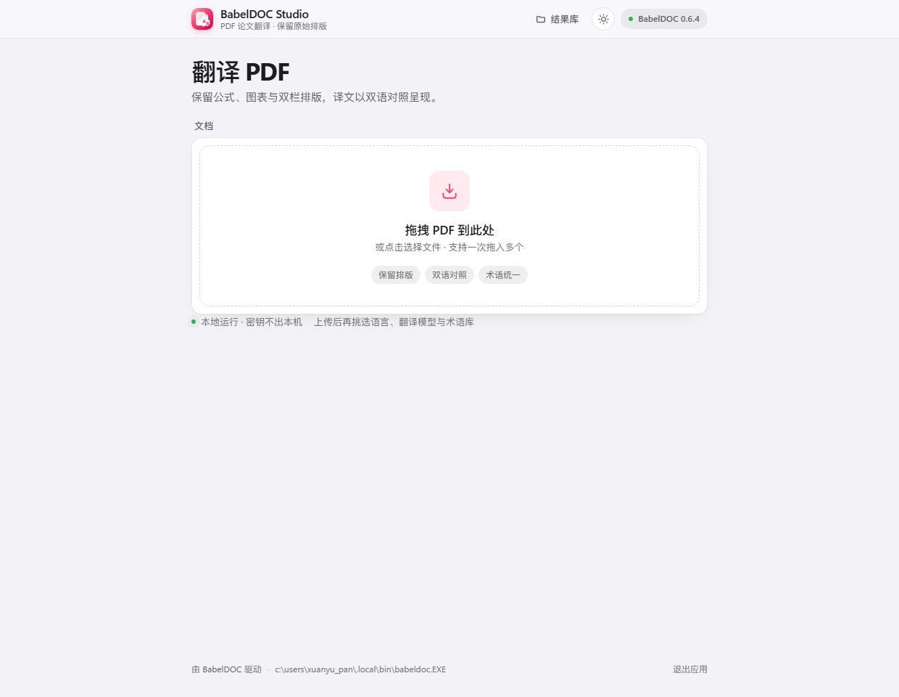
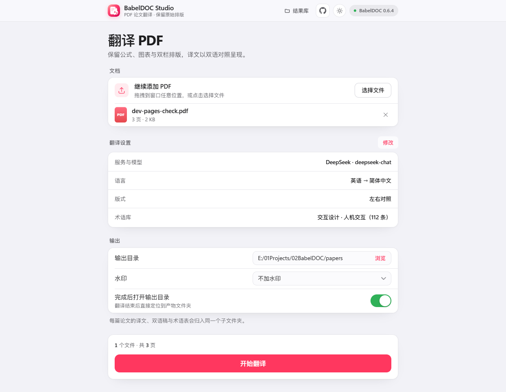
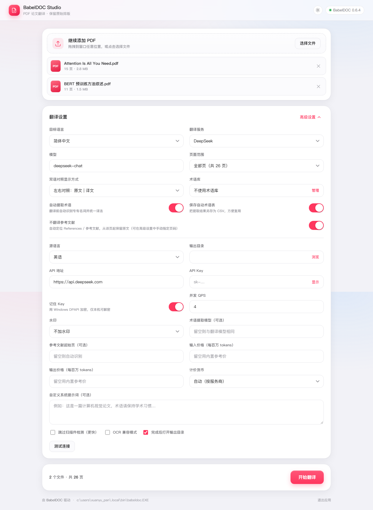
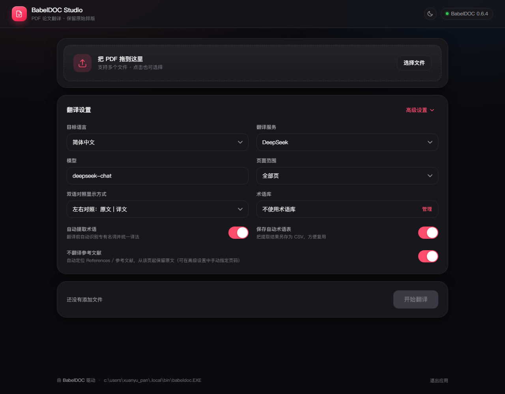
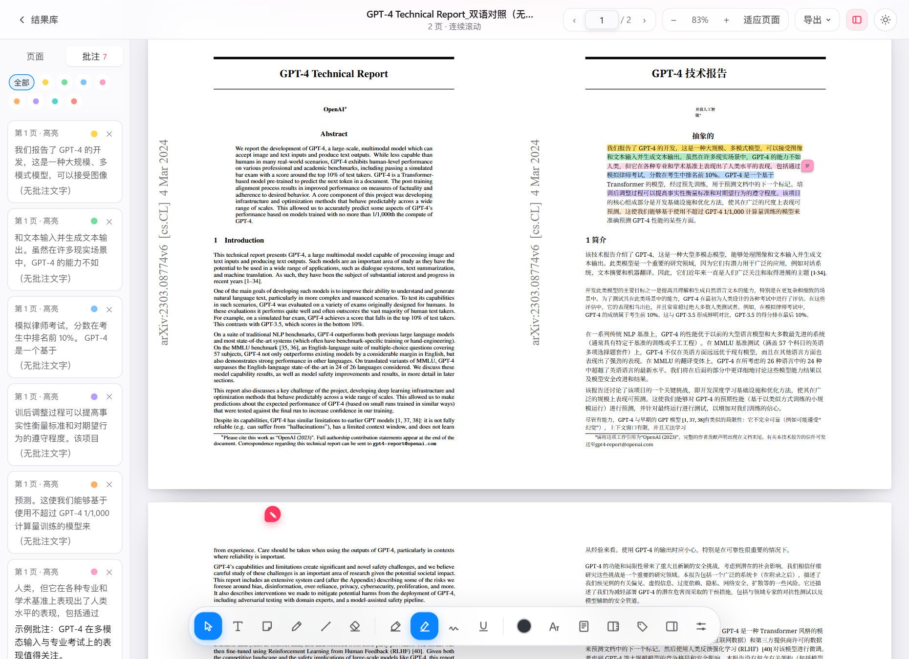
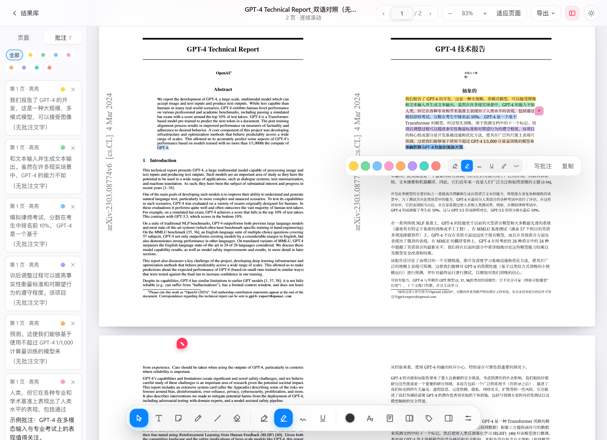
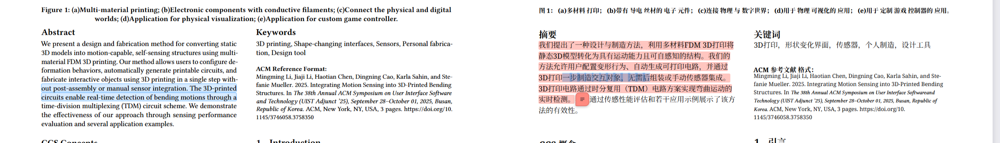

# BabelDOC Studio

> 仓库：<https://github.com/PiDesign-314/Pi_BabelDOC-Studio>

一个面向 **PDF 论文 / 技术文档** 的桌面级翻译工具：底层调用
[BabelDOC](https://github.com/funstory-ai/BabelDOC)（保留原始排版、公式、图表），
上层是本项目自研的 **iOS 风格可视化界面**，可自由配置任意 OpenAI 兼容大模型。

> 本目录由旧版 Tkinter 脚本（`babeldoc_gui.py`）迁移而来，现已重写为
> 「本地 Web 服务 + 浏览器应用窗口」架构。

## 界面

上传前只保留一个拖拽入口，界面上没有任何表单：



拖入 PDF 之后才展开翻译设置，文件列表在上方，随时可以继续添加：



开始翻译后，进度以一张文件卡片呈现：左侧文件名与大小，右侧百分比与已用时间；
卡片背景是缓慢流动的毛玻璃渐变（只是装饰，与进度无关）：


高级设置（API 地址、Key、输出目录、QPS、提示词等）：



深色模式（右上角 ☀/☾ 按钮在 跟随系统 → 浅色 → 深色 之间切换）：



翻译完成后进入「结果库」，左侧可以按合集分组，译文、双语对照、术语表按论文归组，可搜索、排序、归类、重命名、清理：


点开就在应用内阅读，选中正文可高亮；带备注的划线行尾有便签标志，鼠标悬停即可预览备注：



选中正文后可以用八种颜色标记，也可以原地改色：



读「左右对照」的双语 PDF 时，在哪一侧划词，另一侧同一段落对应的句子会同步亮起：



术语库自带两套预设（人工智能、交互设计），一键添加即可让全文术语统一：


## 功能

- **先上传，再设置**：入口页只有一个拖拽区域，拖入 PDF 后才出现语言、模型、术语库等选项；
  移除全部文件后平滑回到入口页。
- **拖拽即翻译**：把 PDF 拖到窗口任意位置即可，支持多文件、点击选择、自动读取页数。
- **过渡动画**：入口与工作区之间淡入切换、拖拽高亮、文件增删与设置卡片依次浮现，
  并遵循系统的「减少动态效果」设置。
- **结果库**：自动把同一篇论文的 `_译文` / `_双语对照` / `_术语表` 归到同一张卡片下
  （磁盘上它们也放在以论文命名的子文件夹里，见「结果文件」），
  支持搜索、按时间 / 名称 / 大小排序、整套重命名、移入回收站、打开所在文件夹，
  也可以把其它目录加进来一起管理。
- **文献合集**：结果库左侧可以建若干合集（按课题、项目或阅读阶段分组），
  点卡片上的「归类」勾选即可把论文放进合集；顶部可按合集筛选、查看「未分类」，
  合集可重命名 / 删除（只解除归类，不删文件）；论文重命名后合集归属仍保留。
- **翻译进度卡片**：翻译中显示一张文件卡片 —— 文件图标、文件名、大小 / 页数，
  右侧是百分比与已用时间；卡片是毛玻璃质感的动态渐变背景，颜色只跟状态有关：
  完成转绿并显示「用时」，失败转红。
- **双语对照同步**：读「左右对照」的双语 PDF 时，在哪一侧划词，另一侧同一段落里
  对应的译文 / 原文会同步亮起（拖动过程中实时跟随，松手后保留，点空白处消失）；
  段落按版面位置配对，译文比原文短（少排几行）时也能落在对应的句子上。
- **内置阅读器**：PDF.js 本地渲染，页面连续滚动（一页接一页，读到页尾自然接上下一页），
  缩略图导航、缩放、适应宽度 / 适应页面，完全离线；Ctrl + 滚轮缩放，方向键整页跳转，
  结果卡片一键打开，阅读时不必跳出应用；再次打开同一篇会自动回到上次读到的页码。
  长文档按视口增量渲染：页面偏移缓存在内存里，高亮直接用保存的行带绘制，
  文字层只在真正读到的页面上延迟构建。
- **阅读批注**：选中正文弹出工具栏，八色高亮（黄 / 绿 / 蓝 / 粉 / 橙 / 紫 / 青 / 红，
  按行合并成连续色带、文字保持清晰，跨页选择会一次性标完整段）；
  「批注」工具可在页面任意位置放便签并写评论；
  带备注的划线会在行尾显示便签标志，鼠标悬停展开备注预览，点击进入编辑；
  点侧栏里的批注会直接跳到对应文字并闪一下提示位置；
  批注按文档保存在本机，侧栏可统一查看 / 跳转 / 删除，也能导出成 Markdown。
- **带批注的 PDF**：右上角「导出」里可以把批注写进一份 PDF 副本（`…_批注.pdf`，与原文件放在一起）。
  高亮与便签写成标准 PDF 注释，Acrobat / Edge / 预览 / Zotero 都能直接看到；
  把这份 PDF 发给别人，或在另一台机器上打开，本阅读器发现本地没有批注时会自动从 PDF 里读回来继续写。
- **预设术语库**：随应用附带「人工智能 · 大模型」（124 条）与「交互设计 · 人机交互」
  （112 条）两套中英术语，首次启动自动安装，删掉后可在术语库面板一键重新添加。
- **任意大模型**：OpenAI / DeepSeek / 智谱 GLM / 通义千问 / OpenRouter / Moonshot /
  自定义网关，模型名可手填，API Key 用 Windows DPAPI 加密保存在本机。
- **页面范围**：全部页或 `1-5,8` 这样的自定义范围。
- **双语对照方式**：左右对照（原文 | 译文）、交替页、仅译文。
- **术语库**：可视化管理 CSV 术语表（新建 / 编辑 / 导入 / 删除），翻译时注入。
- **自动提取术语**：翻译前自动识别专有名词，可另存为 CSV 复用。
- **不翻译参考文献**：自动定位 References / 参考文献；标题在页首时按页裁剪（确定性），
  在页中（双栏）时改用提示词让模型原样保留条目（可用高级设置手动指定起始页）。
- **实时反馈**：阶段、进度、流式日志、结果文件一键打开。
- **费用估算**：任务结束后显示本次输入/输出 token 与实际花费（内置常见模型参考价，
  可在高级设置里填写自定义单价与货币）。
- 其余：水印开关、QPS 限速、自定义系统提示词、OCR 兼容模式、扫描件检测开关、
  完成后自动打开输出目录。

## 启动

前置条件：

1. 安装 BabelDOC（命令行版）：

   ```powershell
   uv tool install babeldoc
   # 或：pip install babeldoc
   ```

2. Python 3.10+，并安装两个依赖：

   ```powershell
   pip install flask pymupdf
   ```

然后双击 **`启动.bat`**。它会启动本地服务（默认 `http://127.0.0.1:8765`）并用
Edge/Chrome 的应用窗口打开界面。

桌面快捷方式：`BabelDOC Studio`（指向 `pythonw.exe app.py`，图标为
`web/babeldoc.ico`，由 `tools/make_icon.py` 生成）。重复双击不会重复启动服务，
只会再开一个窗口；界面右下角「退出应用」可停掉本地服务。项目路径变动后，
重新运行 `tools/create_shortcut.ps1` 即可刷新快捷方式。

调试时可直接运行（保留控制台输出）：

```powershell
python app.py            # 打开应用窗口
python app.py --server-only   # 只启动服务，自己用浏览器访问
```

## 目录结构

```
app.py                  Flask 服务 + API + 启动器
core/
  config.py             设置持久化（API Key 走 DPAPI 加密）
  providers.py          服务商预设
  languages.py          语言代码表
  glossary.py           术语库 CSV 读写
  pdfinfo.py            页数 / 大小探测
  picker.py             原生文件选择对话框（独立进程）
  runner.py             调用 babeldoc、流式日志、阶段进度、结果重命名
  library.py            结果库：扫描 / 分组 / 合集 / 重命名 / 回收站 / 缩略图
  annotations.py        阅读批注的本地存储
  pdfexport.py          把批注写成标准 PDF 注释，并从 PDF 读回
  presets.py            预设术语库的安装与去重
presets/
  ai-ml.csv             人工智能 · 大模型（124 条，中英对照）
  hci-ux.csv            交互设计 · 人机交互（112 条）
  index.json            预设的名称 / 描述 / 来源
web/
  index.html            翻译界面（入口 + 工作区）
  styles.css            公共样式（浅色 / 深色自适应）
  app.js                翻译界面的交互逻辑
  shared.js             结果库 / 阅读器共用的小工具
  library.html/.css/.js 结果库页面
  viewer.html/.css/.js  内置 PDF 阅读器 + 批注
  pdfjs/                PDF.js 3.11 本地副本（渲染离线可用）
docs/
  BABELDOC-NOTES.md     BabelDOC 集成笔记（CLI、产物命名、术语格式）
  screenshots/          界面截图
tests/
  test_smoke.py         命令拼装 / 阶段识别 / 产物重命名的离线测试
  test_library.py       结果库分组 / 重命名 / 删除、路径白名单、批注读写
  test_presets.py       预设术语库的列举 / 安装 / 只装一次
tools/
  make_icon.py          生成应用图标（web/babeldoc.ico）
  create_shortcut.ps1   重建桌面快捷方式
  push.ps1              提交并推送（直连失败自动走本机代理）
babeldoc_gui.py         旧版 Tkinter 界面（保留备查）
```

## 数据位置

| 内容 | 路径 |
| --- | --- |
| 设置（含加密密钥） | `%APPDATA%\BabelDOC-Studio\settings.json` |
| 术语库 | `%APPDATA%\BabelDOC-Studio\glossaries\*.csv` |
| 拖拽上传的临时 PDF | `%APPDATA%\BabelDOC-Studio\uploads\` |
| 阅读批注 | `%APPDATA%\BabelDOC-Studio\annotations\<文档>.json` |
| 导出的批注 PDF（原目录不可写时） | `%APPDATA%\BabelDOC-Studio\exports\` |
| 结果库附加目录与合集 | `%APPDATA%\BabelDOC-Studio\library.json` |
| 结果库缩略图缓存 | `%APPDATA%\BabelDOC-Studio\thumbs\` |
| 预设术语库安装记录 | `%APPDATA%\BabelDOC-Studio\presets.json` |
| 默认输出目录 | `%USERPROFILE%\Documents\BabelDOC-Studio` |

## 结果文件

BabelDOC 原始产物形如 `论文.zh.mono.pdf` / `论文.zh.dual.pdf`，本工具会自动整理，
**每篇论文一个子文件夹**，同一篇的产物都放在一起，输出目录不再被零散文件铺满：

```
<输出目录>/
  论文/
    论文_译文.pdf
    论文_双语对照.pdf
    论文_术语表.csv
  另一篇论文/
    另一篇论文_译文.pdf
    ...
```

- 子文件夹以论文名命名，重复翻译同一篇会复用这个文件夹；
- 同名文件已存在时追加 `(2)`、`(3)`，不覆盖旧结果；
- 旧版本的平铺结果（直接放在输出目录里）仍然照常识别，结果库里会各自成一张卡片；
- 在结果库里重命名论文时，这个子文件夹会一起改名；删除论文时文件夹一并清掉。

## 已验证

- 命令拼装：`--openai/--pages/--glossary-files/--no-dual/--use-alternating-pages-dual/
  --watermark-output-mode/--custom-system-prompt/--openai-term-extraction-model` 均正确生成。
- 输出整理：`paper.zh.mono.pdf` → `paper_译文.pdf`、`no_watermark` 变体 →
  `paper_译文（无水印）.pdf`、`paper.zh.glossary.csv` → `paper_术语表.csv`。
- 设置持久化：API Key 经 DPAPI 加密，明文不会出现在 `settings.json`。
- 真实调用：用 1 页 PDF 跑通 babeldoc 全流程（版面解析 → 翻译 → 排版 → 产物回收），
  断网/无效 Key 时也能正常回报失败并保留日志。
- 跳过参考文献：2 页样例（第 2 页为 References）实测只翻译第 1 页，
  输出仍是 2 页且第 2 页保留英文原文。
- 费用统计：用本地 mock LLM（每次请求固定 900 输入 / 300 输出 tokens）跑通，
  接口返回 `usage={prompt:1800, completion:600}`、`cost=¥0.0084`（deepseek-chat 参考价）。
- 结果库：产物分组、整套重命名（批注随文件迁移）、回收站删除、附加目录、路径白名单，
  以及批注读写均有离线测试（`tests/test_library.py`）；阅读器用样例 PDF 在无头浏览器里
  跑通选中高亮、便签、批注编辑与刷新后持久化。
- 预设术语库：列举 / 安装 / 只装一次（删掉不回填）有离线测试（`tests/test_presets.py`）；
  安装后出现在翻译表单的下拉里，`tgt_lng=zh` 只对中文目标生效。
- 阅读体验：页面连续滚动，读到页尾直接接上下一页；高亮按字符区间定位，再由实时文本行合并成
  连续色带，跨页选择一次就能标完；旧批注（176 段碎片矩形）打开时自动升级为字符区间，
  缩放、翻页后位置依旧准确。
- 双语对照同步：用 3 页 / 31 MB 的左右对照稿在无头浏览器里实测 —— 中文划词时英文
  一侧同一段落亮起、英文划词时中文一侧亮起，拖动过程中实时更新，点空白处清除；
  单语 PDF 不会出现任何同步标记。
- 结果文件归档：产物落到 `<输出目录>/<论文名>/`，重复翻译复用文件夹并追加 `(2)`；
  结果库能扫描子文件夹，重命名时文件夹一起改名、批注跟随，删除后空文件夹一并移除
  （`tests/test_smoke.py`、`tests/test_library.py` 覆盖）。
- 阅读流畅度：31 页 / 9.8 MB 的双语对照稿在 1280×860 窗口里连续滚动 240 帧，
  优化前平均 39–51 ms/帧（p90 64–112 ms，最长 433 ms），优化后平均 11 ms/帧
  （p90 12–15 ms，最长 61 ms）；滚动过程中读取 DOM 几何的次数从 1508–3543 次降到 0 次
  （页面偏移改为缓存的布局模型，文本层只在真正读到的页面上构建）。
- 带批注的 PDF：32 条批注导出后重新用 PyMuPDF 打开，得到 32 个 `Highlight` 注释，
  位置与原高亮一致；同一条文件再由阅读器打开，会自动读回 32 条批注并写进本地批注库
  （`tests/test_pdfexport.py` 覆盖导出 / 读回 / 跳过非法项 / 忽略他人注释 / API）。
- 八色高亮：黄 / 绿 / 蓝 / 粉 / 橙 / 紫 / 青 / 红都能保存、改色，并各自映射到 PDF 注释的描边色；
  `tests/test_pdfexport.py` 校验前后端色板一致、八种颜色导出后描边互不相同、未知颜色回落到黄色。
- 文献合集：创建 / 重命名 / 删除、归类互斥、按合集与「未分类」筛选、论文重命名后归属保留、
  论文删除后自动移出合集，均有离线测试（`tests/test_library.py`）；结果库页面在无头浏览器里
  跑通「建合集 → 归类 → 筛选 → 改名 → 删合集」全流程。
- 进度卡片：用模拟任务快照在无头浏览器里校验文件名 / 大小 / 页数、百分比、已用时间、
  完成态（绿色 + 用时）与失败态；并校验背景毛玻璃层（`backdrop-filter`）、
  渐变动画（`job-drift`）以及「背景宽度与进度无关」，浅色 / 深色两套主题都检查过。
- 图标：`/favicon.svg` 与 `/favicon.ico` 分别返回 781 B 的矢量图标与 31 KB 的 ICO，
  应用窗口与任务栏不再退回默认地球图标。

## 术语来源

- `presets/ai-ml.csv` 部分词条参考 Yifan Wang 的
  [机器学习中英速查表](https://github.com/wangyifan411/ML-English-Chinese-Cheat-Sheet)（MIT 许可），
  并补充了 Transformer / 大模型相关术语。
- `presets/hci-ux.csv` 由本项目整理，覆盖 HCI、可用性研究与界面设计常用词。

## 已知限制

- 进度是**阶段式**（解析版面 → 提取术语 → 翻译正文 → 排版生成），
  因为 BabelDOC 命令行不提供结构化进度回调。
- 多文件翻译共用同一页面范围与同一模型设置。
- 术语库当前为单选；BabelDOC 支持多文件，UI 后续可扩展。
- 首次翻译需下载版面分析模型/字体，耗时与网速有关。
- 阅读器按视口附近渲染页面（前后各约 1 屏），超长文档的远端页面在滚动到时才排版；
  文字层只对正在阅读的页面构建，暂停滚动后约 0.2 s 内补齐，因此刚滚停就立刻拖选可能需要多试一次。
- 批注默认保存在应用自己的数据目录；「保存带批注的 PDF」会把它们写成标准 PDF 注释，
  但反向只读取本应用写入的注释（其它阅读器添加的高亮不会被导入）。
- 合集是「一篇论文归入若干合集」的标签式分组，不会移动磁盘上的文件；
  扫描结果是按文件名分组的，所以同一文件夹里改了名的论文会在下一次扫描时保留合集归属。
- 双语对照的对应关系是按版面位置推断的（BabelDOC 保留原排版，译文段落与原文段落基本对齐），
  不是逐句对齐：译文比原文紧凑时，高亮可能相差一两行；「交替页」模式（原文页 / 译文页分开）
  不做同步，只有左右对照的单页双栏会触发。
- 结果库只向输出目录下再扫描一层子文件夹；更深的层级不会被自动发现。

## 更新日志

各版本迭代内容见 [CHANGELOG.md](CHANGELOG.md)。

