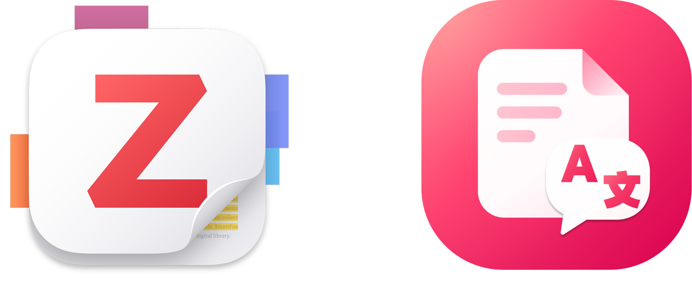
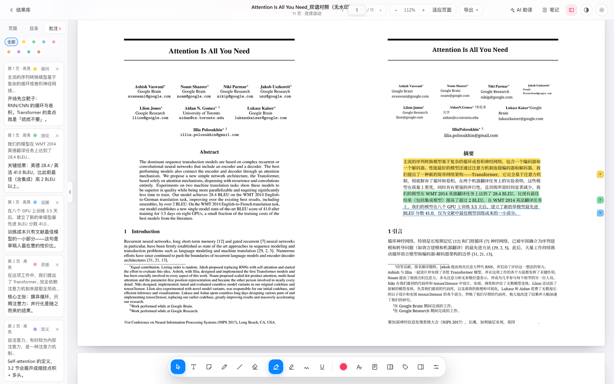
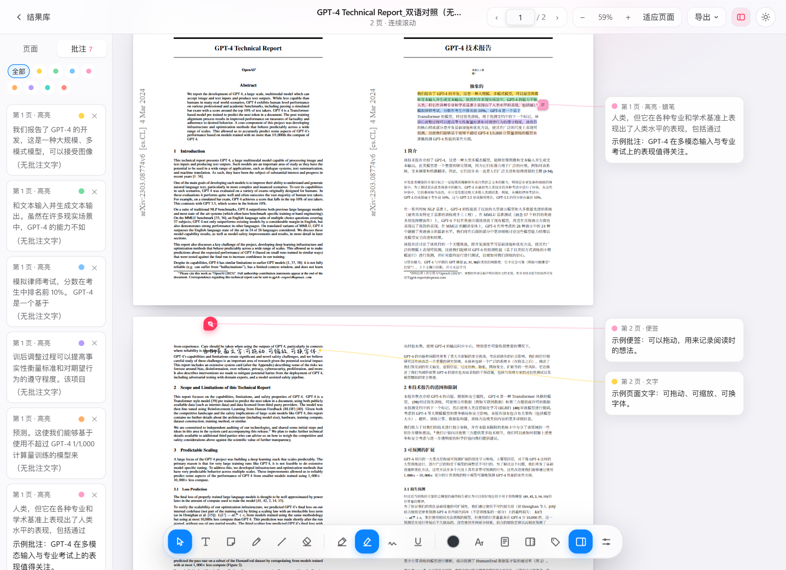
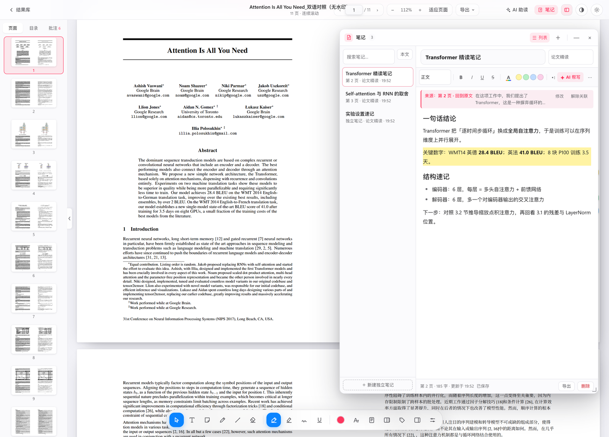
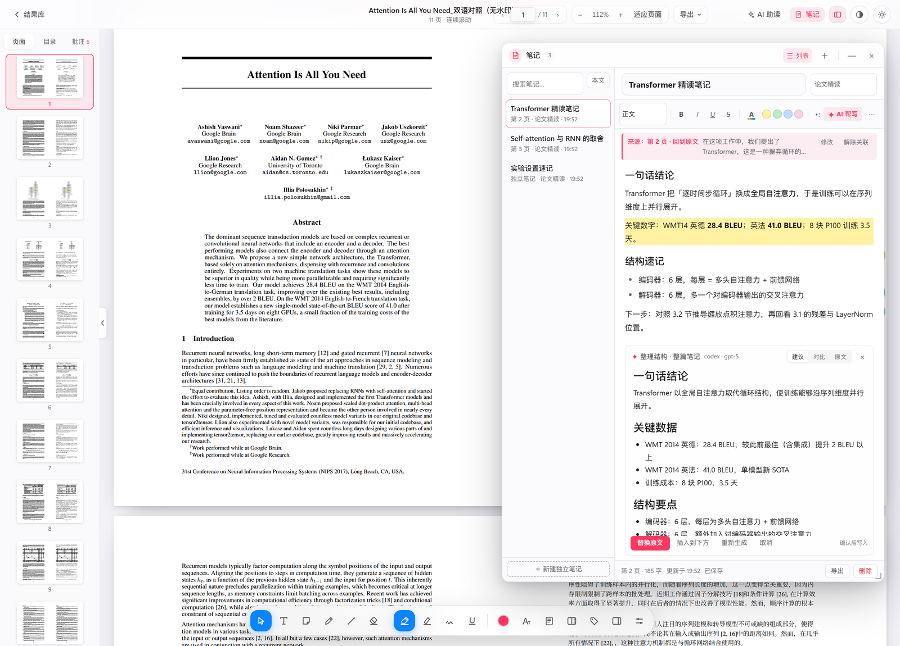
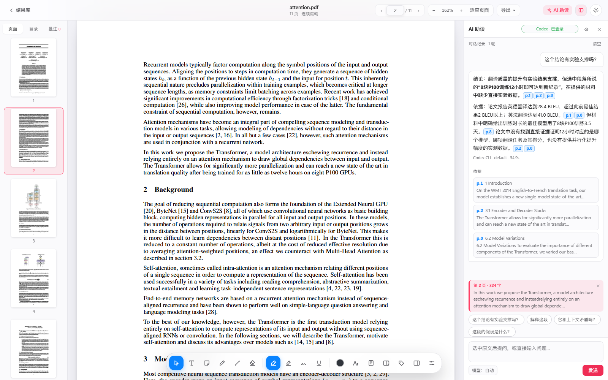
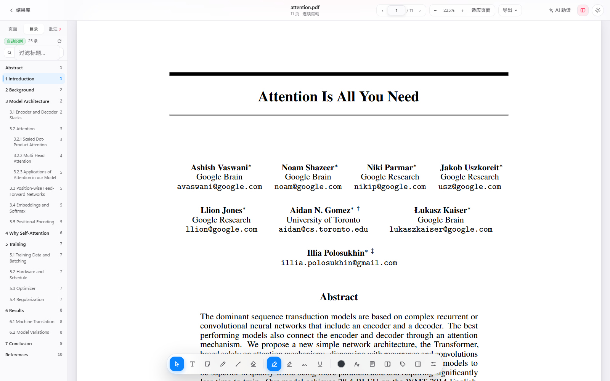
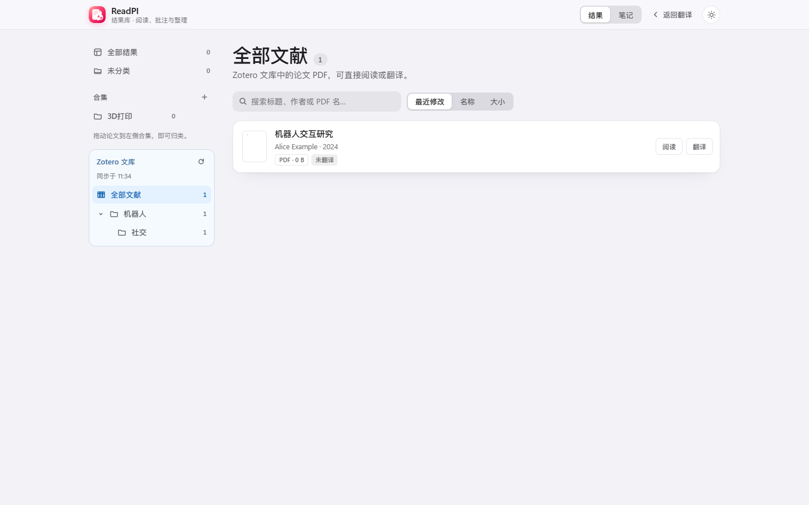
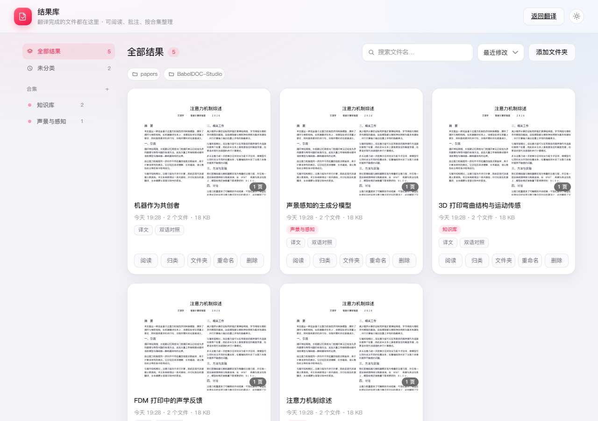
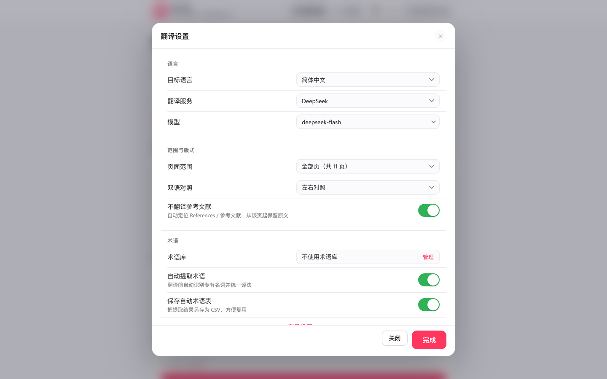

<div align="center">



<h1>ReadPI</h1>

<p><strong>把 PDF 翻译，保留公式、图表和原始排版；Zotero文献库互联、AI 助读、笔记与批注在同一个本地窗口完成。</strong></p>

<p>
  <a href="https://github.com/PiDesign-314/ReadPI/releases/latest">
    </a>
  <a href="https://github.com/PiDesign-314/ReadPI/releases">
    </a>
  <a href="https://github.com/PiDesign-314/ReadPI">
    </a>
  
  
</p>

</div>

ReadPI 是一个面向 **PDF 论文 / 技术文档** 的本地翻译与阅读工作台。底层调用
[BabelDOC](https://github.com/funstory-ai/BabelDOC) 完成版面分析与重排，上层是本项目自研的
**Apple HIG 风格界面**、PDF.js 阅读器、AI 助读、富文本笔记与 **Zotero 接入**。

从「拖入 PDF」到「对照阅读、提问、记笔记、做批注」都在一个应用里完成；PDF、批注、笔记和 API Key
默认只留在本机。

- **免安装版**：Windows x64 ZIP，内置 Python、BabelDOC、离线模型与字体，解压即用。
- **本地优先**：Flask 本地服务 + Edge 应用窗口；API Key 用 Windows DPAPI 加密，论文与笔记不出本机。
- **任意 OpenAI 兼容模型**：DeepSeek、智谱 GLM、Google Gemini、OpenRouter、Ollama、自定义网关；另有内置 Google 免费翻译。
- **Zotero 一键阅读**：在 Zotero 文献列表右键或 PDF 阅读器点「在 ReadPI 中阅读」，自动接入 PDF 并定位到当前页；重复打开复用已有译文、笔记、批注与阅读进度。
- **AI 助读**：选中原文右键引用提问，回答用 `p.N` 标出论文依据，点一下回到原文；默认直接调用本机已登录的 Codex / Kimi / Claude CLI，无需 API Key。
- **笔记与 AI 帮写**：划词、AI 回答或手动新建都能存成笔记；独立悬浮窗口、来源关联、Markdown / HTML 导出，AI 帮写先给建议、确认后才写入正文。
- **完整的阅读与批注**：左右双语、八色高亮与六种样式、手绘下划线、便签、页面文字、页边距批注、术语库与结果库，批注支持 `Ctrl+Z` 撤销。
- **译文完整性防护**：空译文自动重试并拒绝写回，逐段记录译文状态；结果页对空白译页给出页号告警，可一键用兼容模式重译。

> [!TIP]
> **v1.8.1 主要更新**：Zotero 插件 1.0.6（文献列表 / 阅读器一键打开，结果库直读 Zotero 文库）·
> 悬浮笔记与 AI 帮写 · 译文完整性防护（空译文拦截、逐段状态、空白页告警与兼容模式重译）·
> 阅读器 `Ctrl+Z`、页边距批注左右分栏、反色阅读与手绘下划线笔触。
> 完整列表见 [CHANGELOG.md](CHANGELOG.md)。

> [!NOTE]
> 没有 API Key 也能试用：翻译设置里选择「Google 翻译（免费）」，或在本机运行 Ollama。
> Google 免费接口为非官方接口，可能限流，适合预览排版；论文级术语统一建议使用付费模型或术语库。

[更新日志](CHANGELOG.md) · [使用说明](使用说明.txt) · [Zotero 集成](docs/ZOTERO-INTEGRATION.md) · [上游 BabelDOC](https://github.com/funstory-ai/BabelDOC) · [支持语言](https://funstory-ai.github.io/BabelDOC/supported_languages/)

## 界面预览

<div align="center">
  <picture>
    <source media="(prefers-color-scheme: dark)" srcset="docs/screenshots/home-dark.png">
    
  </picture>
</div>

<div align="center">
  
</div>

> 演示截图使用公开论文 **Attention Is All You Need**（arXiv:1706.03762），不包含任何用户个人文档；
> 译文、批注和 Zotero 文库为演示数据，仅用于展示排版、阅读、笔记与批注功能。

## 快速开始

### 下载 Windows 免安装版

1. 打开 [Releases](https://github.com/PiDesign-314/ReadPI/releases/latest)，下载
   **`BabelDOC-Studio-Windows-x64.zip`**（不要下载 GitHub 自动生成的 Source code ZIP）。
   > 安装包沿用 `BabelDOC-Studio-*` 文件名，数据目录也继续使用 `BabelDOC-Studio`，这样从旧版本升级不会丢设置、批注和译文。
2. **先解除锁定再解压**（Windows 11 尤其重要）：右键 ZIP → 属性 → 常规 → 勾选「解除锁定」→ 确定，
   再解压到一个有写入权限的目录。也可以在 PowerShell 里解压，见下面的
   [解压与「智能应用控制」](#解压与智能应用控制)。包内已包含 Python、BabelDOC、依赖、离线模型与字体。
3. 双击 **`Start.bat`** 启动。应用会启动本地服务并打开 Edge / Chrome 应用窗口。
   （包里的 `BabelDOC Studio.exe` 是给代码签名预留的启动器，签名版会以它为默认入口；当前未签名版本在
   开启 SAC 的机器上更容易被拦，优先用 `Start.bat`。）
4. 上传 PDF，选择翻译服务并填入 API Key（或选择 Google 免费翻译），点击「开始翻译」。

> [!NOTE]
> 当前安装包**未做代码签名**，可能遇到两种 Windows 拦截：SmartScreen 的「未知发布者」
> （点「更多信息 → 仍要运行」即可），以及 Windows 11 **智能应用控制**（没有白名单，处理方式见下一节）。
> 更新时关闭旧程序，解压新版本到新目录即可；设置、术语库、批注和译文数据与程序目录分开保存。

### 解压与智能应用控制

Windows 11 的**智能应用控制（SAC）** 会拦截从网上下载的脚本和未签名程序。用资源管理器直接解压时，
ZIP 的「来自 Internet」标记会复制到每个文件，脚本和没有签名的程序都可能被拦，提示
「智能应用控制已阻止可能不安全的文件 / 应用」。按下面顺序处理：

1. **清掉「来自 Internet」标记**：解压前右键 ZIP → 属性 → 勾选「解除锁定」；已经解压过的，在解压
   目录里打开 PowerShell 执行
   `Get-ChildItem -Recurse -File -ErrorAction SilentlyContinue | Unblock-File`（直接粘贴命令，不要存成
   `.ps1` 再运行）。这一步能解决大多数「文件被阻止」的提示。

   > 其实多数情况下**不需要手动输入命令**：包里的 `BabelDOC Studio.exe` 和 `Start.bat` 首次运行时会
   > 自动清掉整个目录的「来自 Internet」标记（完成后写 `.babeldoc-unblocked` 标记，之后跳过）。
   > 但如果 Windows 直接拦住了启动器/脚本本身，它们就没机会执行，仍需先手动解锁被拦的那一个文件。
2. **换一种解压方式**：`Expand-Archive` 或 `tar -xf` 解压不会传播 Internet 标记：

   ```powershell
   Expand-Archive -LiteralPath "$env:USERPROFILE\Downloads\BabelDOC-Studio-Windows-x64.zip" `
     -DestinationPath "$env:USERPROFILE\Documents\BabelDOC-Studio"
   ```

3. **如果提示变成「已阻止可能不安全的应用」**：说明 SAC 拦的是未签名的程序（`pythonw.exe`、
   `*.pyd`，以及包里的 `BabelDOC Studio.exe`）。SAC 没有白名单，只能在「设置 → 隐私和安全性 →
   Windows 安全中心 → 应用和浏览器控制 → 智能应用控制」里关闭它（会降低系统防护，旧版 Windows
   关闭后要重装系统才能再开启），或等待签名版。

> [!NOTE]
> `BabelDOC Studio.exe` 是普通可执行文件，可以参与代码签名；`Start.bat` 是脚本，没法签名。
> **未签名版本**：优先双击 `Start.bat`（它首次运行会自动清掉包内其余文件的标记）；如果它自己被
> 拦住了，先只解锁 `Start.bat`（右键 → 属性 → 解除锁定）再运行，剩下的交给它处理。
> **签名版发布后**：直接双击 `BabelDOC Studio.exe` 就能通过 SAC。维护者签名流程见
> [docs/SMART-APP-CONTROL.md](docs/SMART-APP-CONTROL.md)。

完整的排查步骤、原理和维护者签名清单见
[Windows 智能应用控制排查](docs/SMART-APP-CONTROL.md)；解压目录里也附带了一份
`启动失败看这里.txt`。

### 从源码运行

前置条件：

- Windows 10/11 x64
- Python 3.10+
- 已安装 BabelDOC 命令：

```powershell
uv tool install babeldoc
# 或
pip install babeldoc
```

安装依赖并启动：

```powershell
git clone https://github.com/PiDesign-314/ReadPI.git
cd ReadPI
pip install flask pymupdf
python app.py
```

也可以双击仓库里的 `启动.bat`。调试时：

```powershell
python app.py                 # 启动服务并打开应用窗口
python app.py --server-only   # 只启动本地服务，用浏览器访问 http://127.0.0.1:8765
```

> [!NOTE]
> 在开启智能应用控制的 Windows 11 上，源码运行也可能被拦：`PyMuPDF` 等扩展模块（`.pyd`）
> 没有签名。处理方式见 [docs/SMART-APP-CONTROL.md](docs/SMART-APP-CONTROL.md)。

### 第一次翻译

1. 拖入一份或多份 PDF。
2. 在「翻译设置」摘要里直接选择服务、模型、源/目标语言、双语版式和术语库。
3. 选择商业 API 时，点「更多」填入 API Key；选择 Google 免费翻译或 Ollama 时无需 Key。
4. 点击「开始翻译」。完成后可直接进入内置阅读器，或到「结果库」查看归档文件。

<div align="center">
  
</div>

## 功能与高级选项

### 翻译与版式

- **保留原始结构**：公式、图表、双栏、脚注和页码尽量维持原位置；输出可选 **左右对照、交替页或仅译文**。
- **页面范围**：全部页或自定义范围（例如 `1-5,8`）；「不翻译参考文献」会从 References 起保留原文。
- **术语统一**：内置 AI / 大模型与交互设计两套预设术语库，也可导入自己的 CSV；支持翻译前自动提取术语。
- **兼容性选项**：跳过扫描件检测、OCR 兼容模式、兼容性优先（禁用富文本翻译）、自定义系统提示词、QPS 限速与参考文献起始页。
- **费用可见**：任务结束后显示输入 / 输出 token 和按可配置单价估算的费用，便于比较模型成本。
- **译文完整性防护**（v1.8.1）：
  - 通过 `PYTHONPATH` 注入运行时防护，**不改动已安装的第三方 BabelDOC**：空译文自动按退避策略重试，仍为空则**拒绝应用空译文、保留原文**，也不写入翻译缓存。
  - 逐段记录 `EXTRACTED → QUEUED → TRANSLATING → TRANSLATED → RENDERED` 状态，失败标记为 `EMPTY / FAILED / RENDER_FAILED / KEPT_ORIGINAL`。
  - 每次任务结束后逐段核对源 PDF 与产物，并按版面覆盖率兜底检查整页空白；缺失时给出页号和段落 ID。
  - 结果卡片对大面积空白译页给出页号提示，可一键用兼容模式重译；「保留原文」计为未翻译，不会冒充成功。

> [!TIP]
> 初次翻译需要下载版面分析模型和字体，耗时与网速有关；之后会复用本机缓存。

### 免费与本地模型

| 服务 | 需要 Key | 说明 |
| --- | :---: | --- |
| Google 翻译（免费） | 否 | 应用内置免费接口，不经过大模型；术语与公式保留一般，可能限流 |
| Google Gemini | 是 | AI Studio 提供免费额度；部分地区访问需要代理 |
| OpenRouter 免费模型 | 是 | 模型名以 `:free` 结尾即免费，通常限速或排队 |
| Ollama 本地 | 否 | 本机运行，完全免费；需先安装 Ollama 并拉取模型 |
| OpenAI / DeepSeek / GLM / Qwen / Kimi | 是 | 质量与术语统一最好，按服务商计费 |

> [!WARNING]
> Google 翻译使用非官方免费接口，稳定性和速度不受本项目控制；它不经过大模型，
> 复杂公式、占位符和长难句的效果不如 LLM。重要文档请使用付费模型或配合术语库。

### 阅读与批注

内置 PDF.js 阅读器，打开译文或双语 PDF 即可阅读和标注：

- **双语同步**：在左右对照 PDF 的任意一侧划词，另一侧对应段落会同步亮起；对应关系按版面位置估算，不保证逐词对齐。
- **八色高亮与六种样式**：荧光笔、蜡笔、手绘下划线、实线划掉、铅笔划掉、波浪线；手绘下划线可切轻微 / 自然 / 明显三档笔触；已有标记可原地改样式和颜色。
- **便签与页面文字**：便签可拖动；页面文字直接在页面上输入，拖动左上把手移动、右下把手缩放字号。
- **页边距批注**：批注可以显示在页面内，也可以排到页面右侧或左侧，并用圆角正交引线连回被批注的句子；左右分栏避免引线穿过正文。
- **颜色标签可管理**：颜色标签支持新增（可自选颜色）、删除和拖拽排序，自动保存；删除标签不会删除已有批注。划词后工具条末尾的「＋」可以直接挑一个颜色、创建标签并立即高亮。
- **撤销与重做**：高亮、便签、页面文字、画笔、删除、改色与批注文字修改都进入撤销栈，支持 `Ctrl+Z` / `Ctrl+Shift+Z`（macOS 为 `⌘Z`）。
- **纸面与水墨屏**：原色、暖纸、浅绿、雾蓝、浅粉、水墨屏等纸面；水墨屏只把页面转灰，批注颜色保持原样。
- **反色阅读**：一键把 PDF 页面切成深色背景、浅色文字，仅改变显示，不修改文件也不影响导出；开关状态会记住。
- **导出**：批注自动保存在本机，可导出 Markdown，或导出带标准 PDF 注释的副本（`Ctrl+S`）。

<div align="center">
  
</div>

### 笔记与 AI 帮写

划词、AI 回答或手动新建都能存成笔记，笔记与论文互相跳转：

- **两种笔记**：手动新建默认是**独立笔记**；需要时再关联到原文的某页或某段选中文字，来源信息单独显示，可随时修改或解除关联。
- **悬浮窗口**：不挤占论文阅读区，左侧列表可收起进入专注编辑；窗口可拖动、八向拉伸、最小化与恢复，像 Word 一样用工具栏排版（标题、加粗、重点高亮、待办列表）。
- **自动保存与导出**：编辑实时保存，可导出 Markdown / HTML；结果库按来源文献与自定义分类整理，点击回到原文。
- **AI 帮写**：工具栏里的 ✦ AI 帮写支持润色、学术化、精简、扩展、整理结构、纠正语病，或按自定义要求改写选中内容 / 整篇笔记（范围可切换）。
- **先建议后写入**：结果以建议形式展示对比（建议 / 对比 / 原文），确认后才写入正文，并可一键撤销上次 AI 修改。
- **模型沿用 AI 助读配置**：不会在后台自动上传笔记；只有点击 AI 动作时才发送当前笔记文本。

<div align="center">
  
</div>

<div align="center">
  
</div>

### AI 助读与自动目录

阅读器右上角的「AI 助读」把「选中一句 → 提问 → 回到原文」串成一步：

- **引用提问**：在正文里选中一句，右键选「引用提问…」，选中的原文会作为引用卡片带进右侧面板；可以直接问「这个结论有实验支撑吗？」，也可以用推荐问题里的「解释这段」「它和上下文矛盾吗？」。
- **回答带出处**：回答中的每个论断后面都有 `p.N` 出处芯片，点一下回到对应页并闪烁高亮原文；回答末尾还有「依据」列表（页码 + 章节 + 原文片段）。片段由本机从 PDF 文本里检索补全，不是让模型自由编页码。
- **模型来源**：默认自动检测本机已登录的 **Codex CLI / Kimi Code CLI / Claude Code** 并直接调用，不需要 API Key；也可以在面板的「模型设置」里改用任意 OpenAI 兼容接口（Base URL、模型名、API Key），Key 用 Windows DPAPI 加密保存。CLI 未安装或未登录时会给出具体提示。
- **自动目录**：左侧新增「目录」页签。优先读 PDF 自带书签；没有书签时按字号、加粗、编号和常见章节名自动识别标题（含双栏论文的阅读顺序）。点击条目跳页并高亮标题，滚动时自动高亮当前章节，支持按标题过滤和「重新识别」。
- **隐私**：提问时只把检索到的相关原文片段（约 1 万字以内）发送给你选择的模型；PDF、批注、AI 会话记录都留在本机。

<div align="center">
  
</div>

<div align="center">
  
</div>

### Zotero 集成

运行 ReadPI 1.8.1，在「翻译设置 → Zotero 集成」下载并安装[插件 1.0.6](dist/babeldoc-zotero-1.0.6.xpi) 后，
Zotero 顶部 ReadPI 图标提供「翻译 / 阅读 / 打开结果库」；原有的右键阅读入口也保留。

- **入口**：文献列表右键、PDF 阅读器工具栏按钮、阅读器页面右键；只对本地 PDF 附件显示。
- **直接翻译**：用 Studio 已保存的设置启动所选 PDF 的翻译任务，打开进度页。
- **Zotero 文库**：结果库显示 Zotero 嵌套文件夹和带本地 PDF 的文献，可搜索、阅读或翻译；插件自动同步只读快照。
- **版本检查**：插件优先连接支持 Zotero 接口的新版 Studio；检测到占用端口的旧版会给出明确提示。
- **自动接入**：首次打开会把 PDF 复制到应用的数据目录（不改动 Zotero 原件），并建立与文献、附件的关联；不需要导出或再次上传。应用没启动时会自动启动或引导启动。
- **不重复、不丢成果**：同一附件按 `libraryID + itemKey + attachmentKey` 关联（内容哈希兜底），重复打开复用同一条记录，译文、笔记、批注和阅读位置都保留。
- **位置衔接**：从阅读器发起定位到当前页；从列表发起恢复上次读到的页。译文/双语按页映射，无法准确对应时回退到原文对应页。
- **阅读版本切换**：「阅读 ▾」可分别打开原文、仅译文或左右对照译文（只列出实际存在的版本）。
- **安装**：在「翻译设置 → Zotero 集成」里下载插件，Zotero → 工具 → 插件 → 从文件安装。完整说明与排查见 [docs/ZOTERO-INTEGRATION.md](docs/ZOTERO-INTEGRATION.md)。

Zotero 文库快照是单向只读同步；Studio 不会编辑 Zotero 的文献、文件夹或原 PDF。

<div align="center">
  
</div>

### 页面文字与字体

选中「页面文字」工具后点击页面即可就地输入，不再弹出独立编辑窗口：

- 底部文字格式条可改颜色、字号和字体。
- 字体浮层按「全部 / 我安装的 / 系统」分组（参考 Figma 的分类方式），支持搜索与预览。
- 可导入 `.ttf` / `.otf` / `.ttc` 字体，例如中文手写体；导入字体只保存在本机，不会进入仓库或安装包。
- 文字四周的虚线框可拖动和缩放；位置与字号按 PDF 坐标保存，刷新后保持。

### 术语库与结果库

- 术语库支持新建、编辑和导入 CSV；预设库可在设置里一键安装，按目标语言过滤。
- 结果库把同一篇论文的译文、双语 PDF 和术语表归入同一个子文件夹，支持搜索、排序、重命名、合集、回收站和打开文件所在位置。
- **拖拽归类**：把论文卡片拖到左侧合集即可归入该合集；拖到「未分类」可移出所有合集，也可以继续用卡片上的「归类」多选。
- **右键与版本**：Zotero 文献卡片支持「打开源文件所在位置」；结果卡片可定位到对应译文 PDF，并可切换原文 / 译文 / 双语版本。
- 在结果库中重命名论文时，子文件夹会一起改名，关联批注会跟随迁移。

<div align="center">
  
</div>

### 设置与数据

工作区摘要支持直接编辑；完整设置收在「更多」弹窗里，翻译、模型、版式、术语库、Zotero 集成和高级选项都在一处：

<div align="center">
  
</div>

| 内容 | 路径 |
| --- | --- |
| 设置（含 DPAPI 加密的 Key） | `%APPDATA%\BabelDOC-Studio\settings.json` |
| 术语库 | `%APPDATA%\BabelDOC-Studio\glossaries\*.csv` |
| 阅读批注 | `%APPDATA%\BabelDOC-Studio\annotations\<文档>.json` |
| 笔记与分类 | `%APPDATA%\BabelDOC-Studio\notes.json` |
| 拖拽上传的临时 PDF | `%APPDATA%\BabelDOC-Studio\uploads\` |
| Zotero 接入的 PDF 与关联记录 | `%APPDATA%\BabelDOC-Studio\zotero\` |
| 结果库附加目录与合集 | `%APPDATA%\BabelDOC-Studio\library.json` |
| 默认输出目录 | `%USERPROFILE%\Documents\BabelDOC-Studio` |

- API Key 使用 Windows DPAPI 加密保存，明文不会出现在 `settings.json`。
- 翻译和阅读都在本机完成；只有调用在线模型时才会把文本发送给对应服务商。
- 导出带批注 PDF 时会写入标准注释，原 PDF 文件不会被修改。

## 常见问题

### 启动时提示「智能应用控制已阻止…」怎么办？

这是 Windows 11 **智能应用控制（SAC）** 的拦截，不是安装包损坏。先用
[解压与「智能应用控制」](#解压与智能应用控制) 里的办法清掉文件的「来自 Internet」标记；
如果提示变成「已阻止可能不安全的应用」，说明 SAC 拦的是未签名的 `pythonw.exe` / `*.pyd`，
SAC 没有白名单，只能关闭它或使用签名版。完整的排查步骤见
[docs/SMART-APP-CONTROL.md](docs/SMART-APP-CONTROL.md)。

### 没有 API Key 可以用吗？

可以。翻译设置里选择「Google 翻译（免费）」即可预览排版；也可以在本机安装 Ollama
并使用任意非空字符串作为 API Key。免费选项的质量和稳定性不如付费大模型。

### Google 翻译报错或一直排队？

Google 免费接口可能返回 429 限流，也可能因为网络无法访问。换用付费模型、降低 QPS，
或稍后重试；任务失败时日志里会保留具体原因。

### 译文出现大面积空白怎么办？

v1.8.1 起会在任务结束后检查产物：空译文会被拦截、重试或保留原文，结果卡片会给出空白页页号。
遇到长论文、复杂表格或富文本公式较多时，打开「更多 → 兼容性优先（禁用富文本翻译）」后重新翻译；
仍不完整时可在结果卡片上点「用兼容模式重译」。

### 批注提示「有批注没能保存」？

通常是应用窗口仍连着旧的后端进程（例如更新后没有重启）。阅读器顶部会出现「重启应用」提示条，
点一下会自动重启并刷新。仍失败时请检查 `%APPDATA%\BabelDOC-Studio` 是否可写。

### Zotero 里没有「在 ReadPI 中阅读」？

确认三件事：Zotero 版本是 7.0 及以上；「工具 → 插件」里的 **ReadPI** 已启用；
右键的是**有本地 PDF 附件**的文献（只有网址或还没下载附件的条目不会显示入口）。
插件可在「翻译设置 → Zotero 集成」里重新下载，安装说明和异常排查见
[docs/ZOTERO-INTEGRATION.md](docs/ZOTERO-INTEGRATION.md)。

### 笔记会不会被上传？

不会自动上传。笔记保存在 `%APPDATA%\BabelDOC-Studio\notes.json`；只有你点击「AI 帮写」的某个动作时，
当前笔记或选中文本才会发送给你配置的模型。AI 助读同理，只发送检索到的相关原文片段。

### 支持 macOS / Linux 吗？

当前发布包只提供 Windows 10/11 x64。源码理论上可以在其他桌面系统运行，但字体列表、
原生文件选择器和应用窗口目前主要针对 Windows。

### 会修改原始 PDF 吗？

不会。翻译结果是新文件；阅读批注保存在应用自己的数据目录，只有主动导出带批注 PDF 时才会另存副本。
Zotero 接入也只复制 PDF，不改动 Zotero 原件。

### 怎么更新或卸载？

关闭旧程序，把新版本解压到新目录再启动即可。卸载时删除程序目录；如需清除个人数据，
再手动删除 `%APPDATA%\BabelDOC-Studio` 和「文档」下的 `BabelDOC-Studio`。移动已翻译 PDF
的位置可能会改变批注关联，建议先导出带批注 PDF。

## 背景

上游 [BabelDOC](https://github.com/funstory-ai/BabelDOC) 专注于 PDF 解析、翻译与排版，主要提供
CLI / Python API；普通读者要完成一次舒服的论文翻译，还需要自己准备运行环境、模型 Key、术语表，
再找外部阅读器查看译文和做批注。

ReadPI 把这条链路收进一个本地桌面应用：

- 用本地 Flask 服务封装 BabelDOC，提供可视化任务、阶段进度、产物归档、完整性校验和费用统计；
- 内置 PDF.js 阅读器，把「翻译 → 对照阅读 → 高亮/便签/页边距批注 → 导出」放在同一个窗口；
- 把 AI 助读、自动目录、富文本笔记和 AI 帮写接进阅读流程，让「读不懂」到「记下来」不需要切换应用；
- 用 Zotero 插件把文献管理里的 PDF 直接带进来，复用已有译文、笔记和阅读进度；
- 用 Apple HIG 风格重做设置、结果库和阅读工具坞，减少命令行参数和配置文件的心智负担；
- 所有数据默认留在本机，在线模型只负责翻译文本和回答提问。

## 路线图

- [x] Windows 免安装包（内置 Python / BabelDOC / 离线资源）
- [x] 内置 PDF 阅读器、八色高亮、六种标记样式与页边距批注
- [x] 页面文字就地编辑、字体分组与导入字体
- [x] 结果库、术语库预设、费用统计
- [x] 免费模型与 Google 免费翻译适配
- [x] AI 助读：引用提问、回答带 `p.N` 出处、点击回到原文
- [x] 自动识别目录（PDF 书签 / 字号启发式）与章节跳转
- [x] Zotero 集成：一键阅读 / 翻译、结果库 Zotero 文库、位置与成果复用
- [x] 富文本笔记、来源关联与 AI 帮写
- [x] 译文完整性校验、空译文拦截与兼容模式重译
- [ ] 扫描版 PDF 的完整 OCR 流程
- [ ] macOS / Linux 安装包与原生字体列表
- [ ] 同时启用多个术语库
- [ ] 更细粒度的逐段翻译进度
- [ ] 更多导出格式（全文 Markdown / DOCX）

## 已知限制

1. 进度是**阶段式**的（解析版面 → 提取术语 → 翻译正文 → 排版生成），不是逐段精确进度；完整性校验会补充逐段状态。
2. 多文件任务共用同一套页面范围、语言和模型设置。
3. Google 免费翻译是非官方接口，限流、失效和区域网络问题不受本项目管理。
4. 扫描版 PDF 的 OCR 兼容模式仍在完善，复杂扫描件可能需要先做 OCR；完整性校验对无文本层的页面只能做版面兜底判断。
5. 双语同步按版面位置估算，不是逐句对齐；交替页模式不做同步。
6. 阅读器按视口附近懒加载页面，刚滚动到新页时文字层可能有一小段补齐延迟。
7. 页面文字导出到 PDF 时使用兼容字体，可能与阅读器中选择的本地字体略有差异。
8. 目前只提供 Windows 字体列表；macOS / Linux 会回退到系统通用字库。
9. AI 助读默认调用本机已登录的 Codex / Kimi / Claude CLI；未安装或未登录时，需要在面板里改用 API Key，或先在终端完成对应 CLI 的登录。
10. 自动目录是启发式识别：没有样式、没有编号的标题可能漏掉，且最多扫描前 80 页；可以点「重新识别」重试，或在有 PDF 书签的文件上使用。
11. 回答里的页码由模型按给定材料标注，再由本机校验并补全引用片段；极少数压缩或特殊排版的 PDF 可能定位不到原文，此时会跳到对应页而不是高亮具体行。
12. 免安装包目前**未做代码签名**，Windows 11 智能应用控制（SAC）开启时会被拦截；处理办法见 [解压与「智能应用控制」](#解压与智能应用控制) 和 [docs/SMART-APP-CONTROL.md](docs/SMART-APP-CONTROL.md)。
13. Zotero 插件面向 Zotero 7+，只做「Zotero → ReadPI」的单向只读同步；不会把笔记或批注写回 Zotero。

## 开发

### 项目结构

<details>
<summary>展开目录说明</summary>

```text
app.py                  Flask 服务 + API + 启动器
core/
  config.py             设置持久化（API Key 走 DPAPI 加密）
  providers.py          服务商预设
  runner.py             调用 BabelDOC、流式日志、阶段进度、产物重命名
  babelguard/           运行时防护：空译文重试、逐段状态与缓存保护
  translate_qa.py       译文完整性校验：逐段核对与版面覆盖率兜底
  library.py            结果库：扫描 / 分组 / 合集 / 重命名 / 回收站 / 缩略图
  annotations.py        阅读批注的本地存储
  notes.py              富文本笔记、分类与来源关联
  ai_reader.py          AI 助读：检索、prompt、CLI / API 适配、引文解析
  toc.py                目录：PDF 书签读取与启发式标题识别
  fonts.py              本机 / 导入字体注册与字体文件服务
  pdfexport.py          把批注写成标准 PDF 注释，并从 PDF 读回
  zotero.py             Zotero 插件接口、附件接入与位置映射
  zotero_library.py     Zotero 文库只读快照
  presets.py            预设术语库的安装与去重
presets/                内置术语库 CSV（AI / 大模型、交互设计）
web/
  index.html            翻译界面（入口 + 工作区）
  library.html          结果库
  viewer.html           内置 PDF 阅读器 + 批注
  app.js               工作区交互
  viewer.js            阅读器与批注逻辑
  notes.js             悬浮富文本笔记 + AI 帮写
  reader-toc.js        阅读器目录面板
  reader-ai.js         阅读器 AI 助读面板
  reverse-reading.js   反色阅读
  hand-underline.js    手绘下划线渲染
  styles.css / viewer.css / notes.css / reader-ai.css
  pdfjs/                PDF.js 本地副本
tests/                  离线测试与阅读器 UI 冒烟
tools/                  图标、便携包构建、Zotero 插件、签名与快捷方式
docs/screenshots/       文档截图
```

</details>

### 测试与构建

```powershell
# 单元测试
python -m pytest -q

# 阅读器 UI 冒烟（Playwright + Edge）
python tests/reader_ui_smoke.py

# 划词选区绘制回归（连续色带 / 无叠色 / 预览与高亮一致）
python tests/selection_paint_ui.py

# 标记样式 / 颜色标签 / 页边距引线 / 反色阅读（Playwright + Edge）
python tests/style_tools_ui.py
python tests/color_tags_ui.py
python tests/leader_lines_ui.py
python tests/reverse_reading_ui.py

# AI 助读 + 自动目录 / 笔记与 AI 帮写（Playwright + Edge）
python tests/reader_ai_toc_ui.py
python tests/notes_ui_smoke.py

# Zotero 接入与插件
python tests/test_zotero.py
python tests/test_zotero_prepare.py

# 构建 Windows 免安装包（未签名）
python tools/build_portable.py

# 构建 Zotero 插件
python tools/build_zotero_plugin.py

# 审计包内 exe / dll / pyd 的签名状态
powershell -NoProfile -ExecutionPolicy Bypass -File tools/sign_release.ps1 `
  -Path dist/BabelDOC-Studio-Windows-x64 -Mode Audit

# 带代码签名构建（需要证书，先看 docs/SMART-APP-CONTROL.md）
$env:SIGN_CERT_THUMBPRINT = '<证书指纹>'
python tools/build_portable.py --sign
```

> [!NOTE]
> 构建产物在 `dist/BabelDOC-Studio-Windows-x64.zip`，并生成对应的 SHA-256 校验文件；
> 打包脚本不会复制个人设置、密钥或论文。构建会用 Windows 自带的 .NET Framework `csc.exe`
> 编译 `BabelDOC Studio.exe` 启动器（找不到时退化为 `Start.bat`）。未签名的包在开启 Windows 11
> 智能应用控制的机器上会被拦截，发版前请按 [docs/SMART-APP-CONTROL.md](docs/SMART-APP-CONTROL.md) 检查签名状态。

## 参与贡献

欢迎提交 Bug、可复现的 PDF、文档修正和兼容性改进。涉及解析、渲染、翻译服务集成或大范围 UI
改动的 PR，建议先开 Issue 讨论，避免与当前路线冲突。

提交前请至少运行：

```powershell
python -m pytest -q
python tests/reader_ui_smoke.py
python tests/selection_paint_ui.py
```

请不要把 `dist/`、`papers/`、`.tmp/`、个人 API Key 或论文 PDF 提交到仓库。

## 致谢

- [BabelDOC](https://github.com/funstory-ai/BabelDOC)：PDF 解析、翻译与排版核心
- [PDF.js](https://mozilla.github.io/pdf.js/)：内置阅读器
- [Flask](https://flask.palletsprojects.com/)、[PyMuPDF](https://pymupdf.readthedocs.io/)：本地服务与 PDF 处理
- [Zotero](https://www.zotero.org/)：文献管理与插件宿主
- 所有 OpenAI 兼容模型服务商，以及提供免费额度的 Google AI Studio / OpenRouter / Ollama
- 术语预设参考了公开的机器学习与 HCI 术语资料，详见 `presets/`
- 文档演示截图使用公开论文 *Attention Is All You Need*（arXiv:1706.03762），版权归原作者所有

## Star History

<a href="https://star-history.com/#PiDesign-314/ReadPI&Date">
  <picture>
    <source media="(prefers-color-scheme: dark)" srcset="https://api.star-history.com/svg?repos=PiDesign-314/ReadPI&type=Date&theme=dark" />
    <source media="(prefers-color-scheme: light)" srcset="https://api.star-history.com/svg?repos=PiDesign-314/ReadPI&type=Date" />
    
  </picture>
</a>

---

各版本更新内容见 [CHANGELOG.md](CHANGELOG.md)。

> 仓库原名 `Pi_BabelDOC-Studio`，现更名为 `ReadPI` 与工具名保持一致；旧链接和旧 Release 地址会自动跳转。
